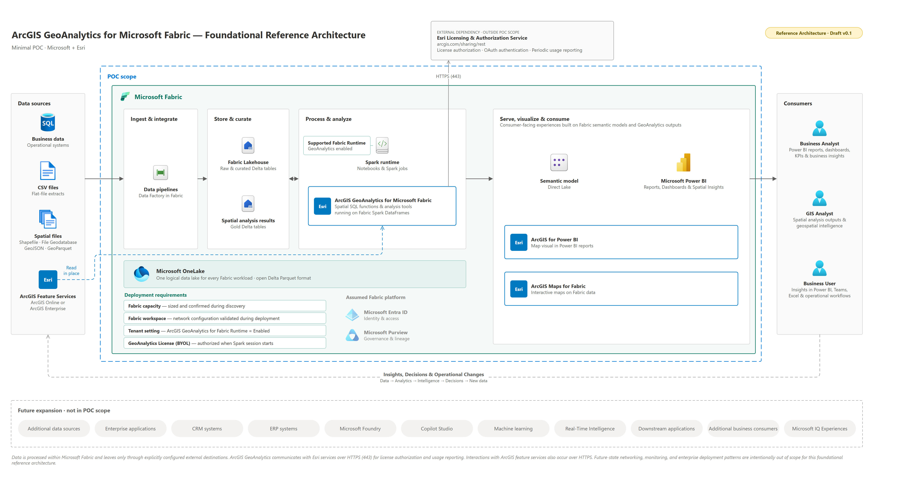

# ArcGIS GeoAnalytics for Microsoft Fabric: Customer Guidance

## Executive Summary

ArcGIS GeoAnalytics for Microsoft Fabric runs distributed spatial analysis inside Microsoft Fabric Spark, so Esri and business data can be enriched where it already lives. This page gives the Fabric foundation, what a customer needs in place to run it, the three stages of the scenario, and how to scope a proof of concept. For the full landscape, see [01 · Microsoft + Esri Foundation](../01-Microsoft-Esri-Foundation/).

---

## ArcGIS GeoAnalytics in the Microsoft Fabric Ecosystem

The Microsoft + Esri landscape is anchored by five integrations. Three run in Microsoft Fabric and Power BI: **ArcGIS GeoAnalytics for Microsoft Fabric**, **ArcGIS Maps for Microsoft Fabric**, and **ArcGIS for Power BI**. Two extend the story: **ArcGIS for Microsoft 365** and **ArcGIS on Microsoft Azure**. The full landscape is described in [01 · Microsoft + Esri Foundation](../01-Microsoft-Esri-Foundation/README.md#microsoft--esri-fabric-integration-landscape).

Within that landscape, GeoAnalytics provides the **spatial processing** step:

| Capability | Role in the landscape | Covered in |
|---|---|---|
| **ArcGIS GeoAnalytics for Microsoft Fabric** | Distributed spatial analysis and enrichment in Fabric Spark | This guide |
| ArcGIS Maps for Microsoft Fabric | Mapping and spatial visualization within Fabric | [03 · ArcGIS Maps for Microsoft Fabric](../03-ArcGIS-Maps-for-Fabric/) |
| ArcGIS for Power BI | Location-aware reporting for business users | [Stage 3: Use the Results](05-Stage-3-Use-the-Results.md) |

These capabilities are related but not interchangeable. GeoAnalytics typically produces the spatially enriched data that the mapping and reporting experiences consume.

---

## Fabric Foundation

ArcGIS GeoAnalytics runs within Microsoft Fabric, so every Esri integration in this library starts from a well-designed Fabric workload. This library adopts Microsoft Fabric guidance rather than restating it. Customers should review the Microsoft Fabric Well-Architected Framework when planning a proof of concept or production deployment.

**Source:** Microsoft Learn, [Microsoft Fabric workloads, Azure Well-Architected Framework](https://learn.microsoft.com/en-us/azure/well-architected/microsoft-fabric/overview) ([SRC-MSFT-016](records/Source-Register.md#src-msft-016)). Microsoft also provides a [Visio version of the reference architecture](https://arch-center.azureedge.net/fabric-architecture.vsdx).

### Where Esri Fits

| Area | Esri Role |
|-------|------------|
| Data sources | ArcGIS Online and ArcGIS Enterprise data copied into OneLake or accessed in place ([Stage 1](03-Stage-1-Bring-Data-into-Fabric.md)) |
| Spatial processing | ArcGIS GeoAnalytics runs in Fabric Spark and enriches data spatially ([Stage 2](04-Stage-2-Spatial-Processing.md)) |
| Consumption | ArcGIS Maps for Microsoft Fabric and ArcGIS for Power BI ([Stage 3](05-Stage-3-Use-the-Results.md)) |
| Outside Fabric | ArcGIS service communication over HTTPS (443) ([Stage 2 minimum deployable POC](04-Stage-2-Spatial-Processing.md#architecture)) |

### Microsoft Fabric Design Guidance

Review these Microsoft Fabric guidance areas with the customer's platform team before beginning a proof of concept:

| Pillar | Why It Matters |
|---------|----------------|
| [Reliability](https://learn.microsoft.com/en-us/azure/well-architected/microsoft-fabric/reliability) | Recovery and availability expectations for Spark jobs and their outputs |
| [Security](https://learn.microsoft.com/en-us/azure/well-architected/microsoft-fabric/security) | Workspace isolation, identity, access control, and networking |
| [Cost Optimization](https://learn.microsoft.com/en-us/azure/well-architected/microsoft-fabric/cost-optimization) | Capacity sizing and operational cost management |
| [Operational Excellence](https://learn.microsoft.com/en-us/azure/well-architected/microsoft-fabric/operational-excellence) | Deployment pipelines, monitoring, and lifecycle management |
| [Performance Efficiency](https://learn.microsoft.com/en-us/azure/well-architected/microsoft-fabric/performance-efficiency) | Capacity planning and workload isolation for Spark processing |

One design consideration applies directly to GeoAnalytics: Spark jobs, pipelines, queries, and refreshes share Fabric capacity. Spatial processing workloads can compete with interactive workloads, so Microsoft recommends appropriate scheduling, workload isolation, and capacity planning. ([Microsoft Learn](https://learn.microsoft.com/en-us/azure/well-architected/microsoft-fabric/overview)).

---

## What You Need to Run GeoAnalytics

GeoAnalytics is not a standalone service. It runs only inside Microsoft Fabric, so a Fabric foundation is the first requirement. The minimum, as published by Microsoft and Esri:

| # | Requirement | What it means | Source |
|---|---|---|---|
| 1 | **Microsoft Fabric capacity and workspace** | A Fabric workspace on a capacity where Spark can run. Published documentation does not state a minimum capacity size; confirm during discovery. | [Microsoft Learn](https://learn.microsoft.com/en-us/fabric/data-engineering/spark-arcgis-geoanalytics) |
| 2 | **Tenant setting enabled** | A Fabric tenant administrator enables *ArcGIS GeoAnalytics for Fabric Runtime* in the Admin Portal. Capacity administrators can override it per capacity. When disabled, the library is unavailable. | [Microsoft Learn](https://learn.microsoft.com/en-us/fabric/data-engineering/spark-arcgis-geoanalytics); [Evidence SEC-001](records/Evidence.md) |
| 3 | **Fabric Runtime 1.3** | GeoAnalytics is enabled only in the Fabric 1.3 runtime. The library is preinstalled and preconfigured; no separate installation. | [Esri FAQ](https://developers.arcgis.com/geoanalytics-fabric/faq/); [Microsoft Learn](https://learn.microsoft.com/en-us/fabric/data-engineering/spark-arcgis-geoanalytics) |
| 4 | **OneLake data** | A Lakehouse or other supported Fabric data source to read input from and write enriched results back to. | [Microsoft Learn](https://learn.microsoft.com/en-us/fabric/data-engineering/spark-arcgis-geoanalytics) |
| 5 | **Spark notebook or Spark job definition** | Where GeoAnalytics code runs (`import geoanalytics_fabric`). | [Esri FAQ](https://developers.arcgis.com/geoanalytics-fabric/faq/) |
| 6 | **GeoAnalytics license** | Bring your own license: an active GeoAnalytics for Microsoft Fabric subscription, authorized with a username and password or an Esri-provided API key. Usage is metered in compute unit-hours (core-hours). | [Microsoft Learn](https://learn.microsoft.com/en-us/fabric/data-engineering/spark-arcgis-geoanalytics); [Esri authorization](https://developers.arcgis.com/geoanalytics-fabric/authorization/) |
| 7 | **Outbound HTTPS to Esri** | Outbound HTTPS on port 443 to arcgis.com for authorization and usage reporting. Not supported when Outbound Access Protection is enabled. | [Evidence SEC-004, SEC-007](records/Evidence.md) |

### Foundational Reference Architecture

Reference Architecture · Draft v0.1. The minimum Microsoft + Esri architecture for a GeoAnalytics proof of concept, built on the [Fabric Foundation](#fabric-foundation) above.

[](images/geoanalytics-fabric-foundational-reference-architecture.png)

[Open the full-size diagram](images/geoanalytics-fabric-foundational-reference-architecture.png)

How to read it:

- **Inside the POC scope:** data sources flow through Fabric ingestion, the Lakehouse, and Spark with GeoAnalytics, then to the semantic model, Power BI, ArcGIS for Power BI, and ArcGIS Maps for Fabric.
- **Deployment requirements:** the four tags along the bottom of the Fabric box correspond to requirements 1, 2, and 6 in the table above. The "Supported Fabric Runtime" label refers to requirement 3, Fabric Runtime 1.3.
- **Crossing the boundary:** the solid HTTPS (443) line to the Esri licensing service always occurs (requirement 7). The dashed "read in place" line to ArcGIS feature services occurs only when code requests it.
- **Assumed platform and future expansion:** Microsoft Entra ID and Microsoft Purview are standard Fabric platform services, not GeoAnalytics requirements. Items in the Future expansion row are outside the POC.

The [Stage 2 minimum deployable POC diagram](04-Stage-2-Spatial-Processing.md#architecture) shows these requirements in one view, with the calls that cross the Fabric boundary.

**Platform references:**

- **Fabric foundation:** [Fabric Foundation](#fabric-foundation) above, from the Azure Well-Architected Framework.
- **GeoAnalytics component architecture:** [Architecture.md](Architecture.md) shows how GeoAnalytics sits within Fabric (Fabric, Fabric Runtime, Apache Spark, GeoAnalytics) and its dependencies.

---

## The Three Stages

The scenario moves through three stages. Each stage has its own page with discovery questions, flow, architecture, guidance, and handoff. The [End-to-End Scenario](02-End-to-End-Scenario.md) walks through them in order.

```text
Stage 1 · Bring data into Fabric
  Customer data sources → Fabric ingestion or supported connection → OneLake and Fabric data items

Stage 2 · Spatial processing
  Fabric Spark notebook or Spark job definition → ArcGIS GeoAnalytics → Spatially enriched Spark DataFrame

Stage 3 · Use the results
  Customer-approved Fabric or ArcGIS output → Power BI, ArcGIS Maps for Fabric, or ArcGIS apps
```

| Stage | Outcome | Page |
|---|---|---|
| 1 · Bring data into Fabric | Business and spatial data available in OneLake, copied in or read in place from ArcGIS | [Stage 1](03-Stage-1-Bring-Data-into-Fabric.md) |
| 2 · Spatial processing | GeoAnalytics enriches the data in Fabric Spark | [Stage 2](04-Stage-2-Spatial-Processing.md) |
| 3 · Use the results | Enriched output reviewed in the selected consumption experience | [Stage 3](05-Stage-3-Use-the-Results.md) |

---

## Proof-of-Concept Framework

A proof of concept should begin with a clearly defined business decision or analytical question that requires location context. The architecture should then be reduced to the minimum components required to test that question.

A bounded GeoAnalytics proof of concept should identify:

1. **Business question**  
   The operational, analytical, or planning decision that requires location intelligence.

2. **Authoritative business data**  
   The customer dataset representing the relevant asset, event, customer, transaction, or operational condition.

3. **Authoritative geospatial data**  
   The layers, features, boundaries, files, services, or other spatial sources required to provide location context.

4. **Fabric landing or access point**  
   The approved Fabric location or supported connection through which the required data will be accessed.

5. **Spatial operation**  
   The documented GeoAnalytics function or analysis tool required to answer the business question.

6. **Validated output**  
   The spatially enriched dataset, analytical result, or measurable finding the proof of concept is expected to produce.

7. **Consumption experience**  
   The validated experience through which the output will be reviewed, such as Power BI, an ArcGIS application, ArcGIS Maps for Microsoft Fabric, or an approved Fabric data product.

8. **Success criteria**  
   The measurable result that would demonstrate business value, architectural fit, and technical feasibility.

### Industry Proof-of-Concept Scopes

Use these four starting points to turn the
[industry seller scenarios](../01-Microsoft-Esri-Foundation/README.md#if-your-industry-is-here-is-how-geoanalytics-could-work-for-you)
into a bounded customer exercise. These are proposed batch-analysis scopes,
not validated customer deployments, product benchmarks, or guaranteed business
outcomes. Choose one decision, one region, and one data snapshot before expanding.

Each scope follows [Stage 1](03-Stage-1-Bring-Data-into-Fabric.md),
[Stage 2](04-Stage-2-Spatial-Processing.md), and
[Stage 3](05-Stage-3-Use-the-Results.md). Confirm the
[GeoAnalytics prerequisites](#what-you-need-to-run-geoanalytics) and
[network readiness](#network-readiness-discovery) before committing to delivery.

#### Retail: Prioritize Stores with Nearby Unserved Demand

1. Agree on the decision: which existing stores in one market warrant a
   merchandising or coverage review based on nearby demand?
2. Land a dated store extract with stable store IDs, coordinates, and sales,
   plus customer-approved demand points with demand weights. Use aggregated
   or synthetic demand data where customer locations are sensitive.
3. Agree on a straight-line distance threshold in meters. In Fabric Spark,
   construct geometries with explicit spatial references, identify
   store-to-demand pairs within that distance, and assign each matched demand
   point to its nearest store. Break equal-distance ties by stable store ID.
   Keep unmatched demand points for a separate coverage-gap view.
4. Persist a store summary with store ID, assigned demand-point count, summed
   demand weight, sales, and snapshot date. Retain point-to-store assignments
   and unmatched demand separately so reviewers can reconcile the totals.
5. Review demand and sales side by side in a Power BI report and, if needed,
   an ArcGIS for Power BI map. Have the business owner nominate stores for
   follow-up rather than treating proximity as a site-investment recommendation.
6. Accept the POC when every demand point is assigned once or explicitly
   unmatched, total demand weight reconciles to the accepted input within an
   agreed numeric tolerance, and a business owner confirms the assignments
   against the shared spatial validation sample below.

Straight-line proximity is not a drive-time catchment or proof of customer
behavior. Road-network routing, demographic enrichment, and new-site forecasting
require separately validated data, capabilities, and assumptions.

#### Manufacturing: Identify Suppliers Exposed to a Hazard

1. Agree on the decision: which suppliers serving one plant need a continuity
   review for one dated hazard footprint?
2. Land supplier IDs and coordinates, supplier-to-plant relationships, and
   customer-approved hazard polygons with stable hazard IDs and an effective
   date. Resolve duplicate supplier master records before spatial processing.
3. In Fabric Spark, test supplier-point intersections with the hazard polygons.
   Explicitly decide whether points on polygon boundaries count as exposed.
   Join the resulting supplier exposure flags to the plant's supplier list.
4. Persist supplier-hazard matches and a supplier summary with supplier ID,
   plant ID, exposure flag, hazard-match count, and snapshot date. Preserve
   suppliers with no matches as unexposed; label invalid or missing locations
   as unknown, not unexposed.
5. Review the exposed and unknown supplier lists with the plant's supply-chain
   owner in a Power BI report. Keep multiple hazard matches from multiplying
   supplier counts in plant-level summaries.
6. Accept the POC when every in-scope supplier is classified as exposed,
   unexposed, or unknown, distinct supplier counts reconcile to the plant's
   accepted supplier list, and the business owner approves the validation sample.

The result identifies geographic exposure, not a predicted production outage.
Transport-route analysis, disruption forecasting, and alternate-supplier
recommendations are outside this initial scope.

#### Financial Services: Aggregate Property Exposure by Hazard

1. Agree on the decision: which property-backed portfolio segments in one
   region need further hazard-exposure review?
2. Land a customer-approved extract with pseudonymous exposure IDs, property
   coordinates, exposure amounts, currency, and portfolio segments, plus one
   dated hazard layer. Define the record grain so several financial exposures
   on one property are not mistaken for duplicate input.
3. In Fabric Spark, intersect property points with the hazard polygons.
   Preserve detailed exposure-to-hazard matches, then reduce them to one
   exposure flag per exposure ID before aggregating amounts by segment and
   currency. Report missing or invalid locations separately.
4. Persist an access-restricted exposure detail table and an approved segment
   summary containing exposure counts, exposed amounts, unknown-location
   amounts, currency, and snapshot date.
5. Review the aggregate result with the portfolio owner in Power BI. Apply the
   customer's disclosure rules to small groups and validate audience permissions
   before sharing; pseudonymous IDs alone do not make location data anonymous.
6. Accept the POC when counts and amounts reconcile to the accepted extract
   for each currency, overlapping hazards do not double-count the portfolio
   total, and authorized reviewers approve the spatial validation sample.

Geographic exposure is not a credit, underwriting, fraud, or regulatory risk
decision. Loss modeling and customer-level recommendations require separate
validation and governance.

#### Energy: Prioritize Assets for Hazard Review

1. Agree on the decision: which assets in one service territory need inspection
   review against one dated hazard footprint?
2. Land stable asset IDs, point or line geometry, asset class, and the latest
   inspection date, plus customer-approved hazard polygons. Define an analysis
   date and an inspection-age threshold with the asset owner.
3. In Fabric Spark, intersect asset geometries with the hazard polygons and
   retain distinct asset-hazard pairs. Reduce these to one exposure flag per
   asset, then join inspection records by asset ID. Classify exposed assets as
   overdue, current, or inspection date unknown using the agreed threshold.
4. Persist an asset summary with asset ID, asset class, exposure flag,
   hazard-match count, inspection age, review category, and analysis date.
   Keep invalid or missing geometry in an explicit unknown-location category.
5. Review exposed overdue assets and unknown records with the asset owner in
   a Power BI report or a supported ArcGIS Maps for Fabric workflow selected
   through [Stage 3](05-Stage-3-Use-the-Results.md).
6. Accept the POC when every in-scope asset appears once in the summary,
   multiple hazard intersections do not inflate asset counts, threshold and
   missing-date cases match expected categories, and the owner approves the
   spatial validation sample.

This is a review queue, not an automated dispatch or safety decision.
Network tracing, outage prediction, crew routing, and live telemetry processing
are outside this initial scope.

#### Shared Acceptance and Handoff

Agree on these gates before running the selected scenario. The numbers below
are starting acceptance targets for the exercise, not product performance claims.

- Record input owners, usage rights, snapshot dates, record grain, expected
  volumes, spatial references, distance units, boundary rules, and null handling.
  Report rejected records with reasons and reconcile them to the source count.
- Verify the exact spatial functions or analysis tools and parameters against
  the [Stage 2 references](04-Stage-2-Spatial-Processing.md#architecture).
  Do not substitute a network-distance claim for a straight-line calculation.
- Have a domain reviewer label at least 20 expected match and non-match cases,
  or all records if fewer than 20 exist. Include boundary, overlap,
  missing-location, and scenario-specific threshold cases. Require all expected
  results to match; investigate discrepancies before accepting the result.
- Set a maximum elapsed runtime and compute-usage budget with the customer
  before execution. Record capacity, runtime version, input volume, elapsed
  time, and metered usage, and compare the measured values with both limits.
- Rerun against the same snapshot and parameters. Require identical business
  keys, classifications, and counts, with numeric totals within the agreed
  tolerance. Confirm the chosen replace, append, or update behavior does not
  create duplicate published results.
- Test with an approved reader and an unauthorized test identity. Confirm the
  reader can see the intended result and the unauthorized identity cannot access
  restricted detail. Validate refresh using the
  [Stage 3 checklist](05-Stage-3-Use-the-Results.md#validation-checklist).
- Hand off the notebook, input inventory, parameters, output schemas, validation
  results, runtime and usage measurements, access decisions, and unresolved
  issues. Obtain business-owner and platform-owner sign-off before proposing
  production expansion.

Keep Copilot and agent access outside these POCs unless a separately approved
grounding and integration pattern is added. A persisted spatial result is not
automatically available to an agent.

### Network Readiness Discovery

Confirm the customer's network posture early. GeoAnalytics calls Esri services outside Fabric for authentication and usage tracking, and is currently not supported when Outbound Access Protection is enabled ([Evidence SEC-004](records/Evidence.md)). Esri confirms these calls use HTTPS on port 443 to the arcgis.com domain, and that notebook plotting with a basemap also retrieves tiles from Esri ([Evidence SEC-007 to SEC-009](records/Evidence.md)). Behavior with managed virtual networks or Private Link is not yet documented ([Evidence GAP-003](records/Evidence.md#open-evidence-gaps)).

- [ ] Is Outbound Access Protection enabled, or planned, for the target Fabric workspace?
- [ ] Is outbound internet access from Fabric Spark restricted by customer firewall or proxy policy?
- [ ] Does the customer require endpoint or hostname allow-listing for outbound connections? If so, allow outbound HTTPS on port 443 to arcgis.com. *([SEC-007](records/Evidence.md#sec-007))*
- [ ] Does the target workspace use managed virtual networks or Private Link? *(Open: GeoAnalytics behavior not yet documented, [GAP-003](records/Evidence.md#gap-003))*
- [ ] Has the customer's network or security team been engaged to review these requirements before the proof of concept?

If any answer indicates restricted outbound access, raise it as a proof-of-concept risk and escalate to Esri and Microsoft for confirmation before committing to a design.

The objective is not to demonstrate every Microsoft and Esri integration in a single exercise. The objective is to validate a focused and repeatable pattern that can inform a production design.

---

## Scope and Boundaries

This guide describes the documented current-state relationship between Microsoft Fabric and ArcGIS GeoAnalytics for Microsoft Fabric. It does not claim that:

- Every ArcGIS product, service, or data model runs within Microsoft Fabric.
- ArcGIS GeoAnalytics replaces ArcGIS applications or operational GIS systems.
- ArcGIS Online or ArcGIS Enterprise data automatically synchronizes with OneLake.
- ArcGIS Maps for Microsoft Fabric and ArcGIS for Power BI are interchangeable.
- A spatially enriched Fabric dataset is automatically available to copilots or agents.
- GeoIQ, ArcGIS MCP, Microsoft Foundry, or agentic integrations are included in the current GeoAnalytics product architecture.

Agentic, GeoIQ, and MCP integration concepts should be documented separately as reference patterns until their product behavior, identity model, security boundaries, and supported integration paths are validated.

---

## Supporting Technical Records

- [End-to-end scenario walkthrough](02-End-to-End-Scenario.md)
- [Component architecture](Architecture.md)
- [Evidence register](records/Evidence.md)
- [Source register](records/Source-Register.md)
