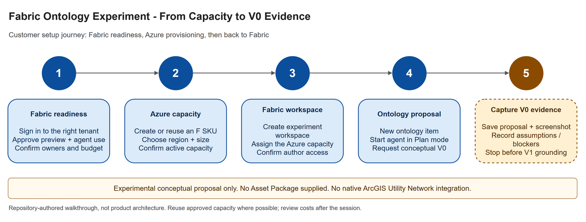

# Fabric Ontology Experiment

## Purpose

This experiment evaluates how established Esri domain models, beginning with
ArcGIS Utility Network, could be represented using Microsoft Fabric Ontology.

> [!IMPORTANT]
> This is experimental technical validation. It does not claim a native
> ArcGIS Utility Network to Microsoft Fabric Ontology integration.

## Intended Progression

1. V0 Conceptual Baseline: preserve the initial AI-generated proposal as a
   hypothesis, not an authoritative Esri model.
2. Esri Asset Package grounding: inspect an actual Esri Utility Network Asset
   Package to identify authoritative domain concepts.
3. V1 Evidence-Grounded Ontology: compare and refine the conceptual model using
   Asset Package evidence.
4. Validation: assess the proposed entities, properties, and relationships
   against the Esri source model and the experiment's objectives.
5. Potential reusable Microsoft + Esri ontology/reference pattern: evaluate
   whether the validated approach can support repeatable semantic grounding.

## Start Here

Follow the [five-step customer walkthrough](customer-walkthrough.md) to move
from Fabric readiness through Azure capacity creation, workspace assignment,
and an initial ontology proposal. The walkthrough stays within this experiment
and includes checkpoints and supporting Microsoft sources.

Then read the [V0 Conceptual Baseline](v0-conceptual-model.md) for the initial
proposed model, its source and method, screenshot evidence, limitations, and
next steps.

The [editable draw.io diagram](../../images/fabric-ontology-experiment-walkthrough.drawio)
captures the same five-step journey.
