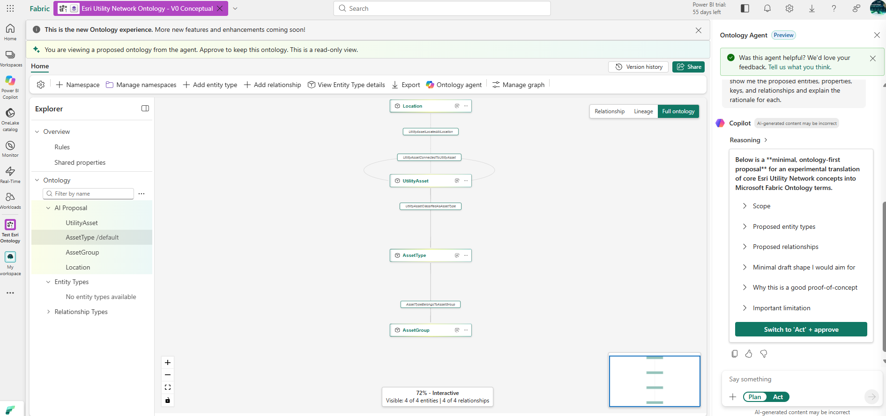

# Esri Utility Network Ontology - V0 Conceptual Baseline

## Purpose

V0 establishes a baseline for representing selected Esri Utility Network concepts
as entities, properties, and relationships in Microsoft Fabric Ontology. It
preserves the initial proposal for comparison with a later evidence-grounded
model.

## Source and Method

* The model was proposed by the Microsoft Fabric Ontology Agent.
* The agent was prompted with general Esri Utility Network terminology and the
  objective of creating a minimal proof of concept.
* No Esri Utility Network Asset Package was supplied to the Ontology Agent.
* No authoritative Esri schema was used to generate this version.
* V0 therefore represents an AI-generated conceptual hypothesis, not an
  Esri-validated ontology.

## V0 Proposed Model

The proposal includes four entities:

* `UtilityAsset`
* `AssetType`
* `AssetGroup`
* `Location`

The proposed relationships are:

* `UtilityAsset classifiedAs AssetType`
* `AssetType belongsToGroup AssetGroup`
* `UtilityAsset locatedAt Location`
* `UtilityAsset connectedTo UtilityAsset`

These constructs are preserved as the initial conceptual baseline. They should
not yet be interpreted as an authoritative mapping of ArcGIS Utility Network.
Any proposed properties, along with these entities and relationships, require
evidence-based validation.

## Evidence

For the setup journey leading to this proposal, follow the
[five-step customer walkthrough](customer-walkthrough.md). It covers Fabric
readiness, Azure capacity, workspace assignment, and starting the ontology agent.

The screenshot shows the Fabric Ontology Agent proposal before approval or
grounding against the Esri Utility Network Asset Package.

## Important Limitations

* AI-generated conceptual proposal
* Not derived from the Esri Utility Network Asset Package
* Not validated against an Esri Utility Network schema
* Does not establish native integration between ArcGIS Utility Network and
  Microsoft Fabric Ontology
* Proposed properties and relationships require validation before being treated
  as authoritative

## Next Step: V1 Asset Package Grounding

The next phase will inspect an actual Esri Utility Network Asset Package and
identify authoritative concepts such as asset groups, asset types, network
structures, attributes/domains, and relevant relationships.

The objective of V1 is to compare the evidence-derived model against V0 and
determine:

* Which AI-proposed concepts survive validation
* Which concepts need to change
* Which additional Esri domain semantics emerge
* Whether an Asset Package can become a repeatable input for creating or
  accelerating Fabric Ontologies

The long-term goal is to evaluate whether established Esri domain models can
provide reusable semantic grounding for Microsoft Fabric and agentic geospatial
scenarios.
