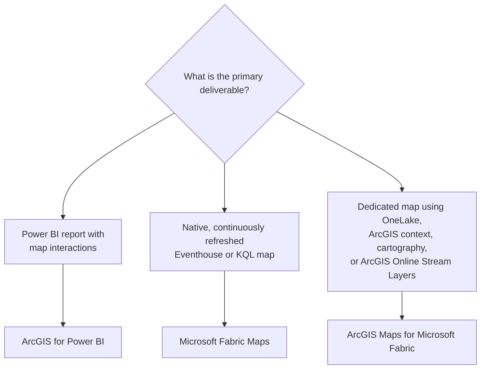

# ArcGIS Maps for Microsoft Fabric: Customer Guidance

## Executive Summary

ArcGIS Maps for Microsoft Fabric provides a map-authoring experience inside Microsoft Fabric. A successful proof of concept requires administrative enablement, qualifying roles in both Fabric and ArcGIS Online, supported source data, a bounded map question, and explicit validation of production gaps.

## Where the Component Fits

Maps for Fabric is the spatial-experience area in the library progression:

```text
Data → Spatial Processing → Spatial Experience
```

This component should not be positioned as a replacement for GeoAnalytics, ArcGIS for Power BI, or operational ArcGIS applications.

## Choose the Right Spatial Experience

ArcGIS Maps for Microsoft Fabric, Microsoft Fabric Maps, and ArcGIS for Power
BI can all present location data, but they produce different artifacts and
serve different workflows. Microsoft Fabric Maps is a native Fabric
capability, not a Microsoft and Esri integration.



These branches describe the primary fit for common scenarios, not mutually
exclusive product boundaries. Other supported data paths may be appropriate
after the required source, refresh, identity, and governance behavior is
validated.

Start with the customer question in the first column, then compare how each
experience answers it.

| Customer question | ArcGIS Maps for Microsoft Fabric | Microsoft Fabric Maps | ArcGIS for Power BI | Supporting evidence |
|---|---|---|---|---|
| What are you creating? | Esri workload item saved in a Fabric workspace | Microsoft-native, first-class Fabric item in a workspace | Esri visualization placed on a Power BI report page | [MAP-001](records/Evidence.md#map-001); [MAP-004](records/Evidence.md#map-004); [MAP-011](records/Evidence.md#map-011); [MAP-014](records/Evidence.md#map-014) |
| What should the user's primary experience be? | Map-centric authoring, exploration, cartography, and spatial storytelling | Real-time operational monitoring across space and time | Report-centric analysis with a map alongside charts, tables, KPIs, and slicers | [MAP-001](records/Evidence.md#map-001); [MAP-011](records/Evidence.md#map-011); [MAP-014](records/Evidence.md#map-014); [MAP-017](records/Evidence.md#map-017) |
| Where will authors build the experience? | Fabric workspace → **+ New item** → **ArcGIS Maps for Fabric** | Fabric workspace → **+ New item** → **Map** | Power BI Desktop or Power BI service → report canvas → **ArcGIS for Power BI** visual | [MAP-004](records/Evidence.md#map-004); [MAP-011](records/Evidence.md#map-011); [MAP-015](records/Evidence.md#map-015) |
| Where does the business data come from? | Supported lakehouse data selected through the OneLake catalog | Eventhouse or KQL database, lakehouse, and Ontology item layers | Data fields supplied by the Power BI report | [MAP-005](records/Evidence.md#map-005); [MAP-011](records/Evidence.md#map-011); [MAP-014](records/Evidence.md#map-014); [MAP-015](records/Evidence.md#map-015) |
| Which external maps, layers, or imagery are required? | ArcGIS Online organizational content and ArcGIS Living Atlas | WFS, OGC API Features, Esri Feature Service, WMS, and WMTS endpoints | Public or secured ArcGIS layers and Living Atlas content, based on account and privileges | [MAP-005](records/Evidence.md#map-005); [MAP-012](records/Evidence.md#map-012); [MAP-014](records/Evidence.md#map-014) |
| Does the map need continuously refreshed event data? | ArcGIS Online Stream Layers are supported; Eventhouse-native refresh is not documented | Eventhouse layers can refresh at defined intervals as new events arrive | Refresh follows the Power BI semantic model and report workflow | [MAP-010](records/Evidence.md#map-010); [MAP-011](records/Evidence.md#map-011); [MAP-014](records/Evidence.md#map-014) |
| Where will spatial processing occur? | ArcGIS capabilities; large-scale processing is a separate GeoAnalytics for Fabric workflow | Azure Maps services or notebooks perform computation; the map presents results | Analysis and map interaction occur within the Power BI visual and ArcGIS context | [MAP-006](records/Evidence.md#map-006); [MAP-011](records/Evidence.md#map-011); [MAP-016](records/Evidence.md#map-016) |
| Does the workflow require ArcGIS identities or content? | ArcGIS Online organizational account required; Public accounts unsupported | No ArcGIS account required for native sources; Esri Feature Service access depends on the endpoint | Guest mode is available with limitations; organizational sign-in enables additional capabilities; Public accounts unsupported | [MAP-003](records/Evidence.md#map-003); [MAP-012](records/Evidence.md#map-012); [MAP-014](records/Evidence.md#map-014) |
| What artifact must be saved and governed? | ArcGIS Maps for Fabric map item | Fabric Map item | ArcGIS map visual stored as part of the Power BI report | [MAP-004](records/Evidence.md#map-004); [MAP-011](records/Evidence.md#map-011); [MAP-015](records/Evidence.md#map-015) |
| Must the map interact with Power BI visuals and filters? | Dedicated map experience; Power BI report interactions are not documented for the item | Dedicated map experience in Fabric Real-Time Intelligence | Participates in the Power BI report experience, including report filters and map selections | [MAP-007](records/Evidence.md#map-007); [MAP-011](records/Evidence.md#map-011); [MAP-014](records/Evidence.md#map-014) |
| How will users receive and access the result? | Save and open are documented; complete sharing and publishing behavior remains a validation gap | Uses Fabric workspace, item, permission, sharing, and lifecycle controls | Uses Power BI report sharing and embedding; secured ArcGIS content can require viewer sign-in | [MAP-007](records/Evidence.md#map-007); [GAP-005](records/Evidence.md#gap-005); [MAP-011](records/Evidence.md#map-011); [MAP-012](records/Evidence.md#map-012); [MAP-014](records/Evidence.md#map-014) |
| Which platform capacity and licenses are available? | Fabric capacity and applicable ArcGIS entitlements; complete pricing interpretation remains a validation gap | Uses Fabric capacity units; no separate map-specific license or SKU | Core visual is included with Power BI; ArcGIS licensing applies to account-dependent capabilities | [GAP-001](records/Evidence.md#gap-001); [MAP-012](records/Evidence.md#map-012); [MAP-016](records/Evidence.md#map-016) |
| When should the customer choose this product? | The map is the primary product and OneLake, ArcGIS content, or ArcGIS cartography is central | Live Eventhouse or KQL monitoring and native Fabric governance are central | The map supports a broader BI report and must work with report measures and interactions | [MAP-013](records/Evidence.md#map-013); [MAP-017](records/Evidence.md#map-017) |

Use ArcGIS Maps for Fabric when the map is the main analytical product and
ArcGIS content or cartographic workflows are central. Use Microsoft Fabric
Maps when continuously refreshed Eventhouse or KQL data and native Fabric
governance define the experience. Use ArcGIS for Power BI when the map belongs
on a report page and must participate in Power BI report interactions.

More than one product may be appropriate for different audiences in the same
solution. Do not assume that their saved artifacts, configurations, identity
behavior, refresh semantics, or sharing models are interchangeable. Validate
each experience independently.

## Foundational Requirements

Complete the shared
[Security and Governance Readiness](../01-Microsoft-Esri-Foundation/Security-and-Governance-Readiness.md)
review before connecting data. Validate Fabric and ArcGIS access, sharing,
external connections, and required audit coverage for the selected map experience.

| Area | Requirement | Evidence |
|---|---|---|
| Fabric tenant | Tenant administrator enables the workload | [MAP-002](records/Evidence.md#map-002) |
| Capacity | Workspace capacity is sufficient to save workload items; minimum SKU is not published | [MAP-002](records/Evidence.md#map-002); [GAP-001](records/Evidence.md#gap-001) |
| Workspace | A Fabric workspace and item location are selected | [MAP-004](records/Evidence.md#map-004) |
| ArcGIS account | Organizational account required; Public accounts are unsupported | [MAP-003](records/Evidence.md#map-003) |
| Map author | ArcGIS Creator or higher and Fabric Contributor or higher | [MAP-003](records/Evidence.md#map-003) |
| Map viewer | ArcGIS Viewer or higher and Fabric Viewer or higher | [MAP-003](records/Evidence.md#map-003) |
| Data | Supported lakehouse, ArcGIS Online, or Living Atlas source | [MAP-005](records/Evidence.md#map-005) |

See [Stage 1](03-Stage-1-Enable-and-Authorize.md) for required API permissions and the implementation sequence.

## Customer Discovery

### Business outcome

- [ ] What decision or analytical question requires a map?
- [ ] Who will use the map, and in which Fabric experience?
- [ ] What measurable result will make the proof of concept successful?

### Data readiness

- [ ] Which Fabric data item is authoritative?
- [ ] Which fields contain coordinates, geometry, addresses, or other location information?
- [ ] What is the coordinate system?
- [ ] What volume, refresh frequency, and latency are required?
- [ ] Is every proposed input documented as supported?

### Identity and access

- [ ] Which Microsoft identity and Fabric role does each user have?
- [ ] Is an ArcGIS identity or license required for the selected capability?
- [ ] Who may create, save, share, and view the map?
- [ ] Which tenant, capacity, or workspace administrators must participate?

### Security and governance

- [ ] Does customer data cross a Microsoft, customer, or Esri boundary?
- [ ] Which endpoints and protocols are required?
- [ ] Are private networking or outbound restrictions in scope?
- [ ] How are saved maps, shared content, and derived outputs governed?

### Production readiness

- [ ] Does the customer require a documented network allow list?
- [ ] What refresh and caching behavior must be validated?
- [ ] Which audit and telemetry records are required?
- [ ] Which geography and data-residency requirements apply?
- [ ] What sharing behavior must be supported beyond saving and opening the item?

## Proof-of-Concept Framework

A bounded proof of concept should identify:

1. A business question that requires spatial visualization.
2. One supported Fabric data source.
3. Documented location fields or geometry.
4. One supported Maps for Fabric workflow.
5. A named audience and access model.
6. A documented save or sharing outcome, if required.
7. Measurable success criteria.

## Recommended POC Stages

| Stage | Owner focus | Outcome |
|---|---|---|
| 1. Enable and authorize | Tenant, Fabric, and ArcGIS administrators | Enabled workload and valid pilot roles |
| 2. Prepare and connect data | Data owner and map author | Supported, approved map layers |
| 3. Build and style the map | Map author and business reviewer | Usable map item |
| 4. Validate and operationalize | Platform, security, and business owners | Validated outcome and production gap list |

Follow the [End-to-End Scenario](02-End-to-End-Scenario.md) for implementation detail.

## Minimum POC Exit Criteria

- [ ] The workload is enabled through an approved administrative process.
- [ ] The selected data belongs to a documented supported category.
- [ ] Required Microsoft and ArcGIS identities and roles are validated.
- [ ] The author can create, save, and reopen the map.
- [ ] The intended viewer can access and interact with the map.
- [ ] The map answers a measurable business question.
- [ ] Network, refresh, telemetry, residency, capacity, and sharing gaps have owners.

## Scope and Boundaries

This guide does not prescribe:

- A production deployment architecture.
- A network allow list.
- A data residency or telemetry statement.
- An integration with Fabric IQ or agentic systems.
- A minimum Fabric capacity SKU.
- A complete publishing or sharing mechanism beyond documented save and open behavior.

## Supporting Technical Records

- [Architecture](Architecture.md)
- [Architecture mapping](Architecture-Mapping.md)
- [End-to-end scenario](02-End-to-End-Scenario.md)
- [Evidence register](records/Evidence.md)
- [Source register](records/Source-Register.md)
- [Collection checklist](records/Collection-Checklist.md)
- [Public research](records/Public-Research.md)
