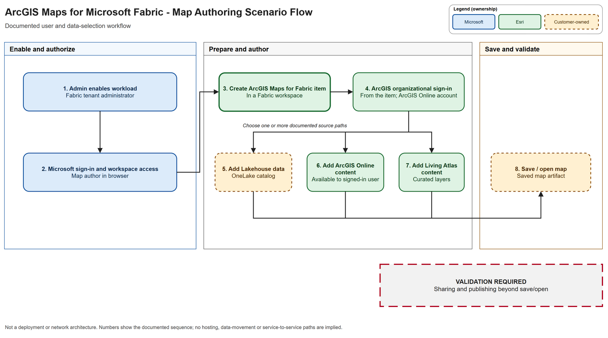
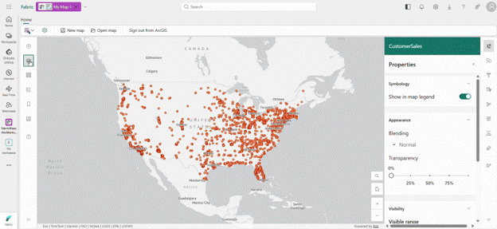
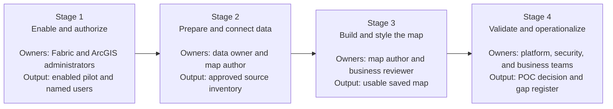

# ArcGIS Maps for Microsoft Fabric: End-to-End Scenario

## Overview

The [Customer Guidance](01-Customer-Guidance.md) explains where ArcGIS Maps for Microsoft Fabric fits and what a customer must have in place. This walkthrough shows how a proof of concept moves from administrative enablement to a saved and validated map.

> [!IMPORTANT]
> This walkthrough assumes that a dedicated ArcGIS map item is the intended
> customer experience. Complete the selection gate below before starting the
> POC. The remaining stages validate the identity, data, authoring, and
> operational model specific to ArcGIS Maps for Microsoft Fabric.

## Select the Spatial Experience

Start with the primary deliverable:

```text
Power BI report with an interactive map
|-- Evaluate ArcGIS for Power BI

Live operational map driven by Eventhouse or KQL
|-- Evaluate Microsoft Fabric Maps

Dedicated map combining OneLake data with ArcGIS Online,
Living Atlas, or ArcGIS cartography
|-- Continue with ArcGIS Maps for Microsoft Fabric
```

See [Choose the Right Spatial Experience](01-Customer-Guidance.md#choose-the-right-spatial-experience)
for the evidence-backed comparison. The presence of another suitable mapping
product does not make the implementation paths interchangeable.

```text
Tenant and identity readiness
    → Supported Fabric and ArcGIS data
    → Map authoring and styling
    → Save, access, and operational validation
```

> **Architecture labeling**
>
> - **Esri reference** means the behavior is documented by Esri.
> - **Microsoft reference** means the behavior is documented by Microsoft.
> - **Scenario view** means the view is adapted for this library from supported product behavior. It is not a Microsoft- or Esri-published architecture.
>
> Every definitive statement in this walkthrough maps to the [Evidence register](records/Evidence.md). Open questions remain labeled as validation work.

## Where ArcGIS Maps Appears in Fabric

ArcGIS Maps for Fabric is created and saved as an item in a Fabric
workspace. The diagram shows the documented user experience and source
selection paths. The Fabric box is a user-experience boundary, not a
deployment, hosting, or network trust boundary.

[](images/arcgis-maps-fabric-scenario-flow.png)

[Open the full-size map-authoring scenario-flow diagram](images/arcgis-maps-fabric-scenario-flow.png)

> [!IMPORTANT]
> Treat this image as a scenario flow, not a deployment or network reference
> architecture. The diagram does not define where Esri workload components execute, how
> traffic is routed, whether data is copied or cached, or where telemetry is
> stored. Those questions remain production validation gaps. The direct-share
> and organizational-app paths shown in steps 9 and 10 are scenario outcomes;
> their supported implementation and governance remain validation work under
> [GAP-005](records/Evidence.md#gap-005). The Power BI path is a separate report-authoring experience, not a
> direct export of the Fabric map item.

## Where Users Go

The documented navigation paths are:

```text
Administrator
Microsoft Fabric
  -> Settings
  -> Admin portal
  -> Tenant settings
  -> ArcGIS Maps for Microsoft Fabric
  -> Enable

Map author
Microsoft Fabric
  -> Target workspace
  -> + New item
  -> Search for ArcGIS Maps for Fabric
  -> New ArcGIS Web Map
  -> Enter name and location
  -> Create
  -> Sign in to ArcGIS

Add data
ArcGIS Maps item
  -> Contents toolbar
  -> + Add data
      -> Add data from Lakehouse
      -> Add data from ArcGIS Online
      -> Add data from ArcGIS Living Atlas
```

[](images/arcgis-maps-general-authoring.gif)

[Open the full-size map-authoring image](images/arcgis-maps-general-authoring.gif)

*Source: [ArcGIS Maps for Microsoft Fabric Is Now Generally Available](https://community.fabric.microsoft.com/blog/fbc_comm_blog/arcgis-maps-for-microsoft-fabric-is-now-generally-available/5373400), Microsoft Fabric Community.*

The interface can change after publication. Use the written navigation path
and current product labels as the implementation reference.

## The Scenario at a Glance



| Stage | Customer question | Stage output |
|---|---|---|
| [1. Enable and authorize](03-Stage-1-Enable-and-Authorize.md) | "Can the right users create and save Maps for Fabric items?" | Enabled workload, pilot workspace, and validated role assignments |
| [2. Prepare and connect data](04-Stage-2-Prepare-and-Connect-Data.md) | "Which supported Fabric and ArcGIS data will the map use?" | A documented set of supported map layers |
| [3. Build and style the map](05-Stage-3-Build-and-Style-the-Map.md) | "Can the user create a useful map in Fabric?" | A styled ArcGIS Maps for Fabric item |
| [4. Validate and operationalize](06-Stage-4-Validate-and-Operationalize.md) | "Can the intended audience reopen and use the saved map under the expected controls?" | A validated POC outcome and a list of production gaps |

## Example POC Question

*Can an operations analyst combine an authoritative lakehouse dataset with approved ArcGIS Online or Living Atlas context, create a clear map in Fabric, save it, and make it accessible to the intended pilot audience?*

Replace this with a customer-specific business decision and measurable success criteria.

## Why Four Stages

Four stages reflect distinct owners and evidence boundaries:

1. Tenant administrators, Fabric workspace administrators, and ArcGIS administrators establish access.
2. Data owners prepare supported sources.
3. Map authors create the experience.
4. Platform, security, and business owners validate access and unresolved production concerns.

Combining these steps hides the product's dual Microsoft and ArcGIS authorization model and makes POC failures harder to diagnose.

## Scenario Variants

| Variant | What changes | Status |
|---|---|---|
| Lakehouse-only map | Stage 2 uses supported GeoJSON, Parquet or GeoParquet, or CSV data | Documented |
| ArcGIS Online context | Stage 2 adds approved organizational or public ArcGIS Online content | Documented |
| Living Atlas context | Stage 2 adds selected ArcGIS Living Atlas content | Documented |
| Streaming layers | Stage 2 uses ArcGIS Online Stream Layer behavior | Public GA announcement; POC validation required |
| Production sharing | Stage 4 defines a supported audience and sharing process | VALIDATION REQUIRED |
| Restricted network | Stage 4 validates required endpoints, data handling, and browser access | VALIDATION REQUIRED |

## Start the Walkthrough

**[Begin with Stage 1: Enable and Authorize →](03-Stage-1-Enable-and-Authorize.md)**

## Related Pages

- [Customer Guidance](01-Customer-Guidance.md)
- [Architecture](Architecture.md)
- [Architecture Mapping](Architecture-Mapping.md)
- [Evidence register](records/Evidence.md)
- [Source register](records/Source-Register.md)
- [Public research](records/Public-Research.md)
