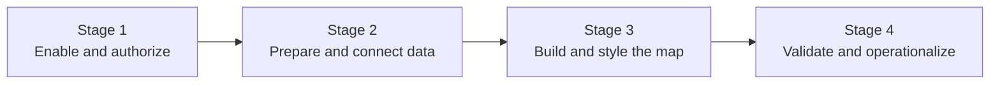

# ArcGIS Maps for Microsoft Fabric: End-to-End Scenario

## Overview

The [Customer Guidance](01-Customer-Guidance.md) explains where ArcGIS Maps for Microsoft Fabric fits and what a customer must have in place. This walkthrough shows how a proof of concept moves from administrative enablement to a saved and validated map.

```text
Tenant and identity readiness
    → Supported Fabric and ArcGIS data
    → Map authoring and styling
    → Save, access, and operational validation
```

> **Architecture labeling**
>
> - **Esri reference** means the behavior is documented by Esri.
> - **Microsoft reference** means the behavior is documented by Microsoft.
> - **Scenario view** means the view is adapted for this library from supported product behavior. It is not a Microsoft- or Esri-published architecture.
>
> Every definitive statement in this walkthrough maps to the [Evidence register](records/Evidence.md). Open questions remain labeled as validation work.

## The Scenario at a Glance



| Stage | Customer question | Stage output |
|---|---|---|
| [1. Enable and authorize](03-Stage-1-Enable-and-Authorize.md) | "Can the right users create and save Maps for Fabric items?" | Enabled workload, pilot workspace, and validated role assignments |
| [2. Prepare and connect data](04-Stage-2-Prepare-and-Connect-Data.md) | "Which supported Fabric and ArcGIS data will the map use?" | A documented set of supported map layers |
| [3. Build and style the map](05-Stage-3-Build-and-Style-the-Map.md) | "Can the user create a useful map in Fabric?" | A styled ArcGIS Maps for Fabric item |
| [4. Validate and operationalize](06-Stage-4-Validate-and-Operationalize.md) | "Can the intended audience reopen and use the saved map under the expected controls?" | A validated POC outcome and a list of production gaps |

## Example POC Question

*Can an operations analyst combine an authoritative lakehouse dataset with approved ArcGIS Online or Living Atlas context, create a clear map in Fabric, save it, and make it accessible to the intended pilot audience?*

Replace this with a customer-specific business decision and measurable success criteria.

## Why Four Stages

Four stages reflect distinct owners and evidence boundaries:

1. Tenant administrators, Fabric workspace administrators, and ArcGIS administrators establish access.
2. Data owners prepare supported sources.
3. Map authors create the experience.
4. Platform, security, and business owners validate access and unresolved production concerns.

Combining these steps hides the product's dual Microsoft and ArcGIS authorization model and makes POC failures harder to diagnose.

## Scenario Variants

| Variant | What changes | Status |
|---|---|---|
| Lakehouse-only map | Stage 2 uses supported GeoJSON, Parquet or GeoParquet, or CSV data | Documented |
| ArcGIS Online context | Stage 2 adds approved organizational or public ArcGIS Online content | Documented |
| Living Atlas context | Stage 2 adds selected ArcGIS Living Atlas content | Documented |
| Streaming layers | Stage 2 uses ArcGIS Online stream-layer behavior | VALIDATION REQUIRED |
| Production sharing | Stage 4 defines a supported audience and sharing process | VALIDATION REQUIRED |
| Restricted network | Stage 4 validates required endpoints, data handling, and browser access | VALIDATION REQUIRED |

## Start the Walkthrough

**[Begin with Stage 1: Enable and Authorize →](03-Stage-1-Enable-and-Authorize.md)**

## Related Pages

- [Customer Guidance](01-Customer-Guidance.md)
- [Architecture](Architecture.md)
- [Architecture Mapping](Architecture-Mapping.md)
- [Evidence register](records/Evidence.md)
- [Source register](records/Source-Register.md)
- [Public research](records/Public-Research.md)
