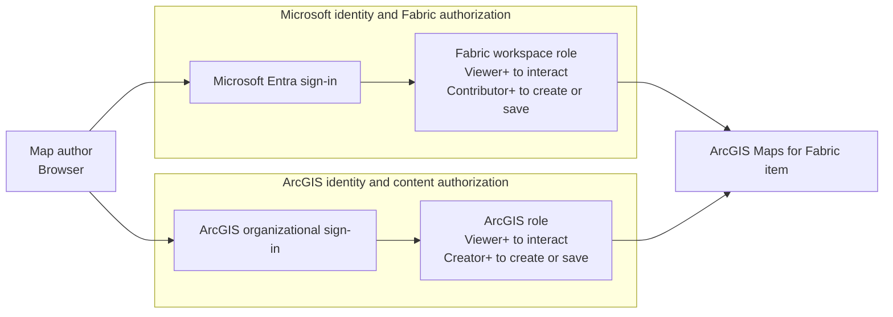

# Stage 1: Enable and Authorize

> ArcGIS Maps for Microsoft Fabric · Part of the [End-to-End Scenario](02-End-to-End-Scenario.md) · Stage 1 of 4

[← End-to-End Scenario overview](02-End-to-End-Scenario.md) | [Stage 2: Prepare and Connect Data →](04-Stage-2-Prepare-and-Connect-Data.md)

---

## Purpose

Enable the ArcGIS Maps for Microsoft Fabric workload and confirm that pilot users satisfy both the Microsoft Fabric and ArcGIS Online access requirements.

## Owners

- Fabric tenant administrator
- Fabric workspace administrator
- ArcGIS Online administrator
- POC technical lead

## Foundational Requirements

| Requirement | Documented behavior | Evidence |
|---|---|---|
| Microsoft Fabric tenant | Users access the workload through Microsoft Fabric in a browser | [MAP-002](records/Evidence.md#map-002) |
| Tenant setting | A tenant administrator enables the ArcGIS Maps for Microsoft Fabric workload | [MAP-002](records/Evidence.md#map-002) |
| Fabric capacity | The workspace capacity must be sufficient to save workload items; no minimum SKU is published in the primary source | [MAP-002](records/Evidence.md#map-002); [GAP-001](records/Evidence.md#gap-001) |
| Fabric workspace | The map is created and saved as an item in a selected workspace and location | [MAP-004](records/Evidence.md#map-004); [MAP-007](records/Evidence.md#map-007) |
| ArcGIS Online organizational account | ArcGIS Public accounts are not supported | [MAP-003](records/Evidence.md#map-003) |
| Dual role assignment | Viewing and saving require qualifying roles in both systems | [MAP-003](records/Evidence.md#map-003) |
| Required API permissions | Azure Storage, Microsoft Graph, and Power BI Service permissions are listed in the Esri Quick Start Guide | [MAP-002](records/Evidence.md#map-002) |

## Required API Permissions

The Esri Quick Start Guide lists these permissions:

| Resource | Permission |
|---|---|
| Azure Storage | `user_impersonation` |
| Microsoft Graph | `offline_access`, `openid`, `profile` |
| Power BI Service | `Fabric.Extend`, `Fabric.Extend.IframeSandbox`, `Item.ReadWrite.All`, `Workspace.Read.All` |

Record how these permissions are granted and reviewed in the customer tenant. The presence of `Fabric.Extend.IframeSandbox` is documented; this library does not infer the workload's hosting or network architecture from the permission name.

## Role Matrix

| Action | ArcGIS Online requirement | Fabric workspace requirement |
|---|---|---|
| View and interact without saving | Viewer or higher | Viewer or higher |
| Create or save a map | Creator or higher | Contributor or higher |

Both requirements apply. A qualifying role in one system does not replace the requirement in the other.

Both authorization paths converge on the map item. The diagram represents
documented user access requirements, not service-to-service authentication or
workload hosting.

## Flow

1. Confirm the customer has a Microsoft Fabric tenant and a workspace on sufficient capacity.
2. In the Fabric Admin portal, enable the **ArcGIS Maps for Microsoft Fabric** tenant setting.
3. Confirm the required API permissions are allowed through the customer's approval process.
4. Select or create the pilot Fabric workspace.
5. Assign map authors the Fabric Contributor role or higher.
6. Confirm each map author has an ArcGIS Online organizational account with Creator access or higher.
7. Assign pilot viewers Viewer access or higher in both systems.
8. Record the tenant, capacity, workspace, ArcGIS organization, and named pilot users.

## Validation Checklist

- [ ] The tenant setting is enabled.
- [ ] The pilot workspace is on capacity sufficient to save an item.
- [ ] Required API permissions are approved.
- [ ] A pilot author has Fabric Contributor access or higher.
- [ ] The same pilot author has ArcGIS Creator access or higher.
- [ ] A pilot viewer has Viewer access or higher in both systems.
- [ ] ArcGIS Public accounts are excluded from the pilot.
- [ ] Licensing ownership and support contacts are recorded.

## Open Questions

> **VALIDATION REQUIRED**
>
> The primary product guide does not publish a minimum Fabric capacity SKU, a separate Maps for Fabric pricing model, regional availability details, or network allow-list requirements. Resolve customer-specific requirements before production rollout.

## Handoff

**Stage 1 produces** an enabled pilot environment and named users with documented roles.

**Stage 2 consumes** that environment and prepares supported data sources.

---

[← End-to-End Scenario overview](02-End-to-End-Scenario.md) | [Stage 2: Prepare and Connect Data →](04-Stage-2-Prepare-and-Connect-Data.md)
