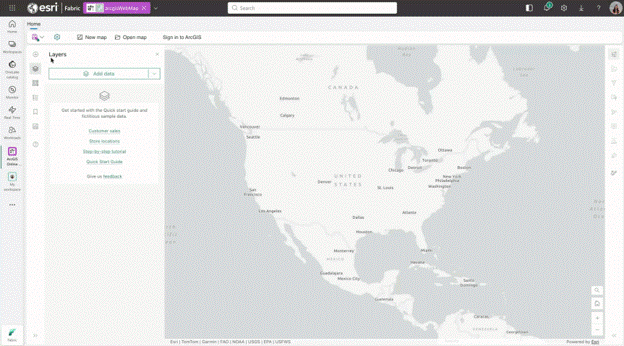
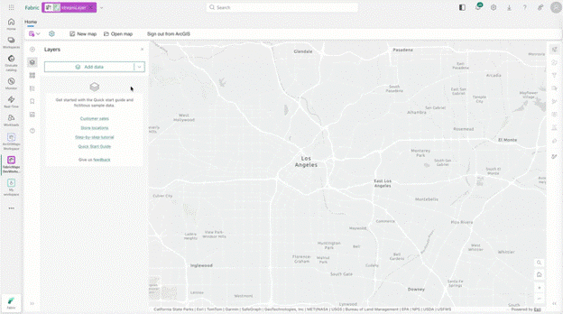

# Stage 2: Prepare and Connect Data

> ArcGIS Maps for Microsoft Fabric · Part of the [End-to-End Scenario](02-End-to-End-Scenario.md) · Stage 2 of 4

[← Stage 1: Enable and Authorize](03-Stage-1-Enable-and-Authorize.md) | [Stage 3: Build and Style the Map →](05-Stage-3-Build-and-Style-the-Map.md)

---

## Purpose

Prepare a bounded set of supported Fabric and ArcGIS data for the pilot map.

## Supported Source Categories

| Source category | Documented path | Evidence |
|---|---|---|
| Fabric lakehouse | **Add data from Lakehouse** through the OneLake catalog browser | [MAP-005](records/Evidence.md#map-005) |
| ArcGIS Online | **Add data from ArcGIS Online** and browse available content | [MAP-005](records/Evidence.md#map-005) |
| ArcGIS Living Atlas | **Add data from ArcGIS Living Atlas** and browse curated content | [MAP-005](records/Evidence.md#map-005) |

## Supported Lakehouse Formats

The Esri Quick Start Guide documents:

- GeoJSON
- Parquet, including geographically enabled Parquet or GeoParquet
- CSV with latitude and longitude fields selected during the add-layer workflow

Local source files can first be uploaded to the lakehouse through Lakehouse Explorer before the map author connects to them.

### Parquet from OneLake

The public general-availability announcement demonstrates adding Parquet data
from OneLake to a map.

[Open the full-size OneLake Parquet image](images/arcgis-maps-onelake-parquet.gif)

*Source: [ArcGIS Maps for Microsoft Fabric Is Now Generally Available](https://community.fabric.microsoft.com/blog/fbc_comm_blog/arcgis-maps-for-microsoft-fabric-is-now-generally-available/5373400), Microsoft Fabric Community.*

> [!NOTE]
> The announcement states that Parquet data can be used directly from OneLake
> without data movement or duplication. Treat that statement as secondary
> product evidence until Microsoft or Esri publishes the corresponding
> technical data-flow documentation.

## Discovery Questions

### Data authority

- [ ] Which lakehouse, ArcGIS Online item, or Living Atlas item is authoritative for the scenario?
- [ ] Who owns each source?
- [ ] Is each ArcGIS Online item approved for the intended audience?

### Location readiness

- [ ] Does the dataset contain supported geometry or location fields?
- [ ] For CSV, which fields contain latitude and longitude?
- [ ] Is the coordinate system documented?
- [ ] Are null, invalid, or out-of-range locations understood?

### Scale and usability

- [ ] How many records and layers are needed for the business question?
- [ ] Can the POC remain within Esri's recommendation of three or fewer layers?
- [ ] Which fields drive labels, pop-ups, filters, and styling?

### Governance

- [ ] Does the customer permit the selected ArcGIS Online or Living Atlas content?
- [ ] Are sensitivity labels, workspace access, and data-owner approvals recorded?
- [ ] Are data movement, caching, and refresh assumptions explicitly treated as validation questions?

## Lakehouse Data Flow

1. Open or create the approved lakehouse.
2. Upload supported files when the source is not already in OneLake.
3. Confirm the file is GeoJSON, supported Parquet or GeoParquet, or CSV.
4. For CSV, confirm latitude and longitude columns.
5. Record the source workspace, lakehouse, file path, owner, and refresh process.

## ArcGIS Content Flow

1. Identify approved organizational, group, favorite, or public ArcGIS Online content.
2. Identify any ArcGIS Living Atlas layer needed for context.
3. Confirm the pilot user's ArcGIS role and content access.
4. Record item identifiers, owners, sharing scope, and intended map role.

### ArcGIS Online Stream Layers

The general-availability announcement demonstrates adding and configuring an
ArcGIS Online Stream Layer.

[Open the full-size Stream Layer image](images/arcgis-maps-stream-layer.gif)

*Source: [ArcGIS Maps for Microsoft Fabric Is Now Generally Available](https://community.fabric.microsoft.com/blog/fbc_comm_blog/arcgis-maps-for-microsoft-fabric-is-now-generally-available/5373400), Microsoft Fabric Community.*

> [!NOTE]
> Stream Layer support is documented in the public announcement but not in the
> primary Quick Start Guide reviewed for this component. Validate supported
> ArcGIS item types, scale, refresh, and operational behavior in the POC.

## Data Readiness Checklist

- [ ] Every source belongs to a documented supported category.
- [ ] Lakehouse formats are supported.
- [ ] CSV latitude and longitude fields are identified.
- [ ] Data owners and sharing scopes are recorded.
- [ ] Fields needed for style, filters, labels, and pop-ups are present.
- [ ] The layer set is limited to what the business question requires.
- [ ] Refresh and caching expectations are recorded as POC tests, not assumptions.

## Open Questions

> **VALIDATION REQUIRED**
>
> The primary guide does not define caching, refresh intervals, snapshot behavior, or a complete data-movement model. A blog describes direct Parquet use without data movement, but that claim requires authoritative technical confirmation before it is used for governance decisions.

## Handoff

**Stage 2 produces** a documented set of supported lakehouse and ArcGIS layers.

**Stage 3 consumes** those layers to build and style the map.

---

[← Stage 1: Enable and Authorize](03-Stage-1-Enable-and-Authorize.md) | [Stage 3: Build and Style the Map →](05-Stage-3-Build-and-Style-the-Map.md)
