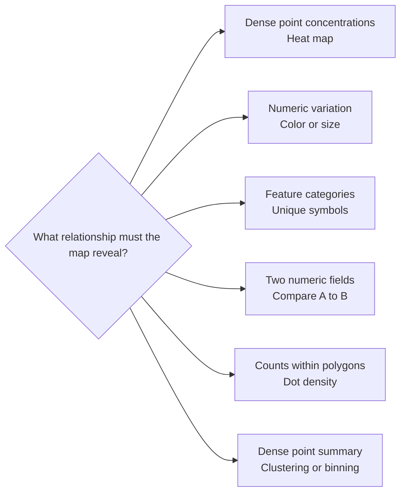
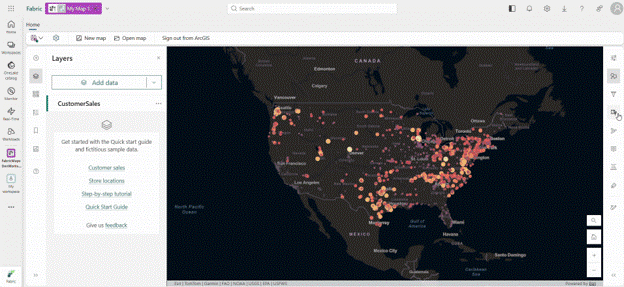
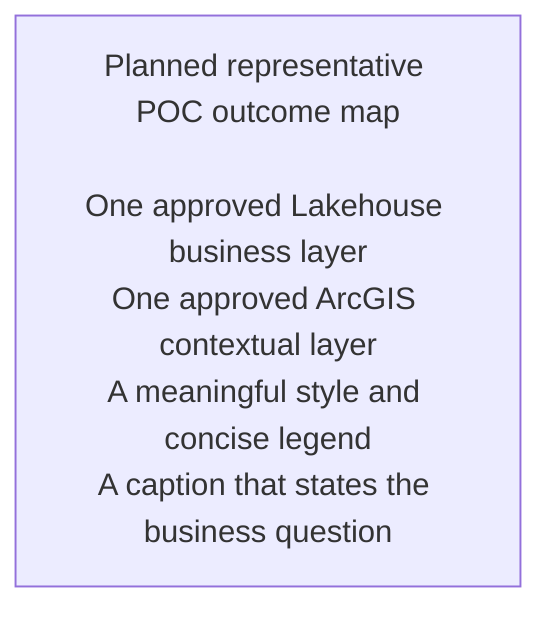

# Stage 3: Build and Style the Map

> ArcGIS Maps for Microsoft Fabric · Part of the [End-to-End Scenario](02-End-to-End-Scenario.md) · Stage 3 of 4

[← Stage 2: Prepare and Connect Data](04-Stage-2-Prepare-and-Connect-Data.md) | [Stage 4: Validate and Operationalize →](06-Stage-4-Validate-and-Operationalize.md)

---

## Purpose

Create an ArcGIS Maps for Microsoft Fabric item, connect the prepared layers, and configure a clear map for the business question.

## Create the Map Item

1. Sign in to Microsoft Fabric.
2. Open the pilot workspace.
3. Select **+ New item**.
4. Search for **ArcGIS Maps for Fabric**.
5. Select the workload item.
6. In **New ArcGIS Web Map**, enter the item name and choose the location.
7. Select **Create**.
8. When prompted, select **Sign in to ArcGIS** and authenticate with the approved ArcGIS Online organizational account.

The ArcGIS sign-in occurs after the user enters Fabric and opens the map item. Keep the Microsoft and ArcGIS identities explicit in support documentation.

[](images/arcgis-maps-general-authoring.gif)

[Open the full-size map-authoring image](images/arcgis-maps-general-authoring.gif)

*Source: [ArcGIS Maps for Microsoft Fabric Is Now Generally Available](https://community.fabric.microsoft.com/blog/fbc_comm_blog/arcgis-maps-for-microsoft-fabric-is-now-generally-available/5373400), Microsoft Fabric Community.*

## Add Lakehouse Data

1. From the Contents toolbar, select **+ Add data**.
2. Select **Add data from Lakehouse**.
3. Browse the OneLake catalog and choose the approved workspace and lakehouse.
4. Select the supported layer or file.
5. For CSV, map the latitude and longitude fields when prompted.
6. Add the layer and confirm that the map navigates to its extent.

## Add ArcGIS Content

Use **+ Add data** to select:

- **Add data from ArcGIS Online** for content available to the signed-in ArcGIS user
- **Add data from ArcGIS Living Atlas** for approved contextual content

Confirm that every added layer matches the approved Stage 2 inventory.

## Configure the Map

The documented settings include:

- Properties
- Styles
- Filter
- Effects
- Aggregation
- Pop-ups
- Fields
- Labels

## Select a Styling Method

| Data question | Candidate documented style |
|---|---|
| Where are dense point concentrations? | Heat map |
| How does a numeric value vary? | Counts and amounts using color or size |
| Which category does each feature belong to? | Unique symbols |
| How does one numeric field compare with another? | Compare A to B |
| How is a count distributed within polygons? | Dot density |
| How can dense points be summarized visually? | Clustering or binning |



Style availability depends on geometry and field type. Select a method that answers the business question rather than demonstrating every option.

Esri recommends limiting a map to three or fewer layers for interpretability. Treat this as design guidance, not a hard technical limit.

## GA Styling Examples

The general-availability announcement demonstrates enhanced symbol animation,
label positioning, and sketching behavior.

[](images/arcgis-maps-symbol-label-sketch.gif)

[Open the full-size symbol, label, and sketch image](images/arcgis-maps-symbol-label-sketch.gif)

*Source: [ArcGIS Maps for Microsoft Fabric Is Now Generally Available](https://community.fabric.microsoft.com/blog/fbc_comm_blog/arcgis-maps-for-microsoft-fabric-is-now-generally-available/5373400), Microsoft Fabric Community.*

Use these images as interface examples. The Quick Start Guide remains the
primary implementation source for supported authoring behavior.

## Representative Outcome Map

The final walkthrough should include one completed map that demonstrates the
business result, not only the authoring interface. The image remains a planned
asset until a public or explicitly approved dataset is selected.



Use the following generation brief for a future screenshot or illustrative
graphic:

```text
Generate a clean 16:9 enterprise location-intelligence map for a fictional
operations scenario. Show one business layer sourced from a Microsoft Fabric
lakehouse and one contextual ArcGIS layer. Use a restrained blue and teal
palette, a clear legend, readable labels, and no customer names or proprietary
data. The map should answer one visible business question and look like a
finished analytical outcome rather than a product marketing image.
```

Save the approved asset as
`images/arcgis-maps-representative-outcome.png`, add source and data attribution,
and replace this placeholder only after validating the visual against the POC
question.

## POC Authoring Checklist

- [ ] The item is created in the intended Fabric workspace and location.
- [ ] The author signs in with the intended ArcGIS organizational account.
- [ ] At least one approved lakehouse or ArcGIS layer is added.
- [ ] The map extent and feature locations are plausible.
- [ ] The selected style matches the geometry, field type, and business question.
- [ ] Labels, pop-ups, and filters expose only necessary information.
- [ ] The map remains understandable with three or fewer layers when practical.
- [ ] Visual effects do not obscure the underlying data.

## Scope Boundary

The Quick Start Guide documents visualization, styling, filtering, effects, aggregation, labels, fields, and pop-ups. It does not document GeoAnalytics-style spatial processing such as spatial joins or track analysis as a Maps for Fabric capability.

Use [ArcGIS GeoAnalytics for Microsoft Fabric](../02-GeoAnalytics-for-Fabric/) when the scenario requires distributed spatial processing before visualization.

## Handoff

**Stage 3 produces** a map item configured for the POC question.

**Stage 4 consumes** the map to validate save, reopen, access, governance, and production gaps.

---

[← Stage 2: Prepare and Connect Data](04-Stage-2-Prepare-and-Connect-Data.md) | [Stage 4: Validate and Operationalize →](06-Stage-4-Validate-and-Operationalize.md)
