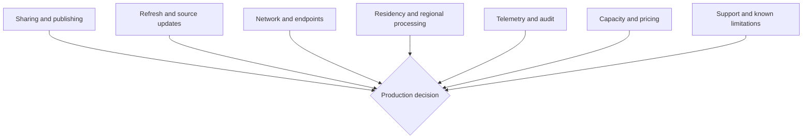

# Stage 4: Validate and Operationalize

> ArcGIS Maps for Microsoft Fabric · Part of the [End-to-End Scenario](02-End-to-End-Scenario.md) · Stage 4 of 4

[← Stage 3: Build and Style the Map](05-Stage-3-Build-and-Style-the-Map.md) | [Back to End-to-End Scenario overview →](02-End-to-End-Scenario.md)

---

## Purpose

Save and reopen the map, validate the documented role boundaries, measure the business result, and identify unresolved production requirements.

## Save and Open

The Esri Quick Start Guide documents:

- **Save** to update the current map
- **Save as** to create a new item with a title and optional description
- Opening a saved map from its location
- An **Open map** command on the ribbon

Saving requires both ArcGIS Creator access or higher and Fabric Contributor access or higher.

## Access Validation

Test with named pilot identities:

| Test | Expected requirement |
|---|---|
| Author creates and saves the map | ArcGIS Creator or higher and Fabric Contributor or higher |
| Viewer opens and interacts without saving | ArcGIS Viewer or higher and Fabric Viewer or higher |
| User with insufficient role attempts to save | Record actual behavior; do not assume the error experience |

The role requirement is documented. The exact failure message and support experience are not documented and should be captured during the POC.

## Business Validation

- [ ] The map answers the defined business question.
- [ ] Feature locations and attributes are plausible.
- [ ] The selected style supports interpretation.
- [ ] The intended author can save and reopen the item.
- [ ] The intended viewer can open and interact with it.
- [ ] The map exposes no unapproved content or fields.
- [ ] The item owner, workspace, and ArcGIS content owners are recorded.

## Production Validation

> **VALIDATION REQUIRED**
>
> The public primary sources do not fully document the following production concerns:

- Sharing or publishing behavior beyond documented save and open workflows
- Refresh, caching, and source-update behavior
- Required network endpoints or firewall allow lists
- Data residency and regional processing
- Telemetry and audit-log coverage
- Minimum Fabric capacity SKU
- Dedicated known-issues and limitations guidance

For each validation gate, record one status: **validated**, **open**, or
**not applicable**. An open gate requires an owner and next action before a
production decision.

For each concern, record:

1. The customer requirement.
2. The observed POC behavior.
3. The Microsoft or Esri support answer.
4. The remaining risk.
5. The production decision owner.

## Suggested POC Tests

These are repository recommendations, not vendor requirements:

- Reopen the saved map after the underlying source changes and record refresh behavior.
- Use browser and enterprise-network diagnostics to identify required endpoints.
- Review available Fabric and ArcGIS audit records for create, save, open, and access activity.
- Test the selected workspace and ArcGIS role combinations.
- Validate the scenario in the customer's intended geography and compliance boundary.
- Record support escalation paths for Fabric platform issues and Esri workload issues.

## POC Exit Criteria

A POC is complete when:

- The workload is enabled through an approved administrative process.
- Named users satisfy the dual role model.
- Supported data is connected through a documented path.
- The map answers a measurable business question.
- The item can be saved and reopened by the intended author.
- The intended viewer can access and use it.
- Production gaps are documented with owners and next actions.

## Handoff

**Stage 4 produces** a validated POC outcome, an evidence-backed implementation record, and a production-readiness gap list.

---

[← Stage 3: Build and Style the Map](05-Stage-3-Build-and-Style-the-Map.md) | [Back to End-to-End Scenario overview →](02-End-to-End-Scenario.md)
