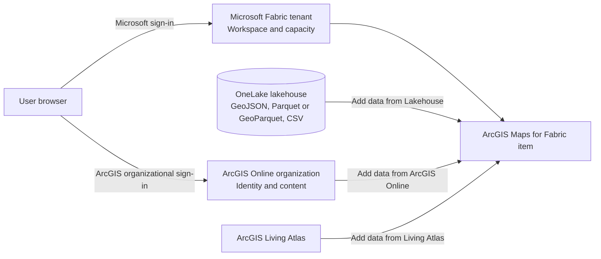

# ArcGIS Maps for Microsoft Fabric Architecture

## Purpose

This document describes the evidence-backed logical architecture of ArcGIS Maps for Microsoft Fabric and separates documented behavior from open deployment questions.

## Architectural Position

ArcGIS Maps for Microsoft Fabric is an Esri mapping workload created as an item in a Microsoft Fabric workspace. It is positioned in this library as the spatial experience that follows data preparation and, when required, spatial processing:

```text
Supported Fabric data → Mapping and exploration experience → Customer insight
```

GeoAnalytics is not a prerequisite for every map. Use it when the source needs spatial processing before visualization.

## Logical Component View



> **Scenario view**
>
> This diagram represents documented user and data-selection workflows. It does not define workload hosting, network paths, caching, data movement, service-to-service communication, or data residency.

## Documented Boundaries

### Administrative boundary

A Fabric tenant administrator enables the workload. The map item is created in a Fabric workspace on capacity sufficient to save items.

### Identity and authorization boundary

The user first accesses Fabric with a Microsoft identity and then signs in to an ArcGIS Online organizational account from the map item.

| Action | ArcGIS requirement | Fabric requirement |
|---|---|---|
| View and interact without saving | Viewer or higher | Viewer or higher |
| Create or save a map | Creator or higher | Contributor or higher |

### Data-source boundary

Documented source categories are:

- Fabric lakehouse data through the OneLake catalog
- ArcGIS Online content available to the signed-in user
- ArcGIS Living Atlas content

### Saved-item boundary

The guide documents Save, Save as, and Open behavior. It does not fully document sharing, publishing, refresh, caching, or source-update behavior.

## Required Platform Components

- Microsoft Fabric tenant
- Enabled ArcGIS Maps for Microsoft Fabric workload
- Fabric capacity sufficient to save items
- Fabric workspace
- ArcGIS Online organizational account
- Required Azure Storage, Microsoft Graph, and Power BI Service permissions
- Supported source data

## Architecture Questions Still Open

1. Where is each workload component hosted and executed?
2. Which endpoints, protocols, and browser origins are required?
3. Does the product copy, cache, query, or transmit data for each source type?
4. What refresh behavior applies after a source changes?
5. Which telemetry and audit events are emitted?
6. Which regional and data-residency controls apply?
7. What is the minimum Fabric capacity SKU?
8. What supported sharing or publishing process applies beyond save and open?
9. Which known limitations affect production deployment?

## Architecture Diagram Guidance

No product-specific vendor deployment diagram was found. A future repository diagram may show the documented logical boundaries above, but it must label network, hosting, data movement, telemetry, and residency as unresolved until authoritative evidence is available.

## Validation Status

Logical Product Architecture Supported; Deployment Architecture Validation Required
