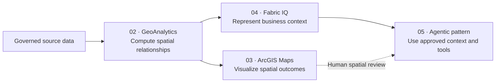

# Fabric IQ + Spatial Intelligence Customer Guidance

## Why This Pattern Exists

GeoAnalytics can determine where assets, incidents, boundaries, and risks relate. ArcGIS Maps can show those results. Fabric IQ adds a governed business vocabulary so people can explore the same operational landscape as assets, work orders, incidents, service areas, and risk areas rather than only as tables and columns.

This pattern is appropriate when the customer needs to:

- Connect spatially derived facts to business entities and relationships.
- Give business and operational users a common vocabulary.
- Explore relationship-centric questions across multiple governed data sources.
- Prepare trusted context for later natural-language and agentic experiences.

## Where It Fits

These are complementary roles, not a mandatory linear product dependency. A customer can implement Fabric IQ without ArcGIS Maps, and ArcGIS Maps does not require an ontology.

## Recommended First Deliverable

Build one bounded ontology proof of concept that answers:

> Which operational assets are located within high-risk service areas, have open work orders, and are associated with recent incidents?

The deliverable is not an enterprise ontology. It is a validated, explainable model with five entity types, a small set of relationships, bound source data, and documented ownership.

## Minimum Foundational Requirements

Complete the shared
[Security and Governance Readiness](../01-Microsoft-Esri-Foundation/Security-and-Governance-Readiness.md)
review before binding data. Validate source permissions, preview approval,
and coverage for any ontology, graph, agent, or export experience selected.

| Requirement | Why it matters | Evidence |
|---|---|---|
| Fabric capacity and a governed workspace | Ontology is a Fabric item and its data bindings require accessible Fabric sources | [IQ-002](records/Evidence.md#iq-002); [IQ-003](records/Evidence.md#iq-003) |
| Permission to create Fabric and ontology items | The required tenant settings must be enabled for the POC users | [IQ-005](records/Evidence.md#iq-005) |
| Approved preview use | Ontology, ontology agent, and related integrations remain preview capabilities | [IQ-003](records/Evidence.md#iq-003); [IQ-008](records/Evidence.md#iq-008) |
| Stable entity keys | Bindings and relationships must refer to durable business identities | Scenario design requirement |
| Governed entity and relationship tables | The model needs attributable data that can be refreshed and tested | [IQ-003](records/Evidence.md#iq-003); [IQ-010](records/Evidence.md#iq-010) |
| GeoAnalytics implementation for required spatial facts | The MVP does not assume native ontology spatial predicates | [IQ-010](records/Evidence.md#iq-010); [GAP-IQ-002](records/Evidence.md#gap-iq-002) |
| Business and data owners | Entity meaning, relationship logic, and answer quality require human approval | Governance requirement |
| Test questions and expected answers | The POC must prove business utility, not only item creation | Validation requirement |

## Minimum Domain Model

| Entity | Minimum properties | Owner question |
|---|---|---|
| Asset | Asset ID, name, type, status, criticality | Which system is authoritative for asset identity and status? |
| Work order | Work-order ID, asset ID, priority, state, due date | Which states count as open and actionable? |
| Incident | Incident ID, category, severity, occurred time | Which incidents are relevant to operational risk? |
| Service area | Service-area ID, name, owner, service level | Who approves boundary changes? |
| Risk area | Risk-area ID, risk type, rating, effective dates | Which source and method establish risk? |

## Minimum Relationships

| Relationship | Derivation | Required for MVP |
|---|---|---|
| Asset has work order | Business key join | Yes |
| Asset associated with incident | Business or spatial association | Yes |
| Asset within service area | GeoAnalytics spatial relationship | Yes |
| Asset within risk area | GeoAnalytics spatial relationship | Yes |
| Service area overlaps risk area | GeoAnalytics spatial relationship | Optional |

## Product and Pattern Boundaries

| Need | Primary fit |
|---|---|
| Compute containment, intersection, or proximity at scale | [02 · GeoAnalytics for Fabric](../02-GeoAnalytics-for-Fabric/) |
| Create a dedicated map experience using supported ArcGIS and Fabric sources | [03 · ArcGIS Maps for Fabric](../03-ArcGIS-Maps-for-Fabric/) |
| Define business entities and governed relationships over Fabric data | Fabric IQ ontology |
| Ask natural-language questions about ontology context | Ontology agent, after validation |
| Build a cross-platform action-taking assistant | [05 · Microsoft + Esri Agentic Reference Pattern](../05-Microsoft-Esri-Agentic-Reference-Pattern/), after the ontology POC |

## Do Not Start With

- A full enterprise ontology.
- A complete Utility Network semantic model.
- Direct ArcGIS-to-ontology integration without product evidence.
- An autonomous agent that takes operational action.
- Every possible spatial relationship.
- Production-scale graph materialization before the bounded ontology is validated.

## Customer Discovery Questions

1. Which operational decision should improve?
2. Which entities must a user understand to make that decision?
3. Which relationships are business joins, and which require spatial processing?
4. Which sources are authoritative for identity, geometry, status, and risk?
5. How current must each relationship be?
6. Who approves entity definitions and relationship logic?
7. Which preview restrictions are acceptable?
8. Which questions and known answers will demonstrate success?

## Proof-of-Concept Exit Criteria

Proceed beyond the POC only when:

- Every entity and relationship has an owner and authoritative source.
- Expected spatial relationships match independently reviewed samples.
- Ontology bindings preserve stable keys and business meaning.
- Test questions produce correct, source-attributable answers.
- Data refresh and schema-change behavior are understood.
- Preview, licensing, region, scale, and support constraints are acceptable.
- Direct product-integration assumptions are removed or backed by evidence.

## Next Step

Follow the [End-to-End Scenario](02-End-to-End-Scenario.md).
