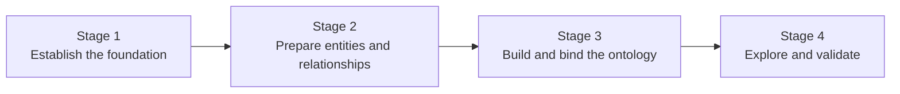
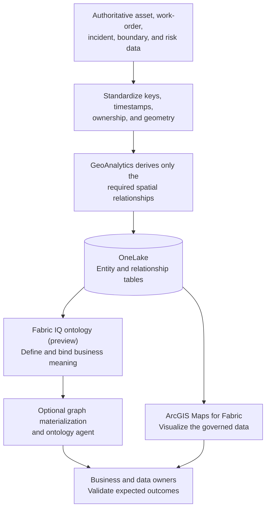
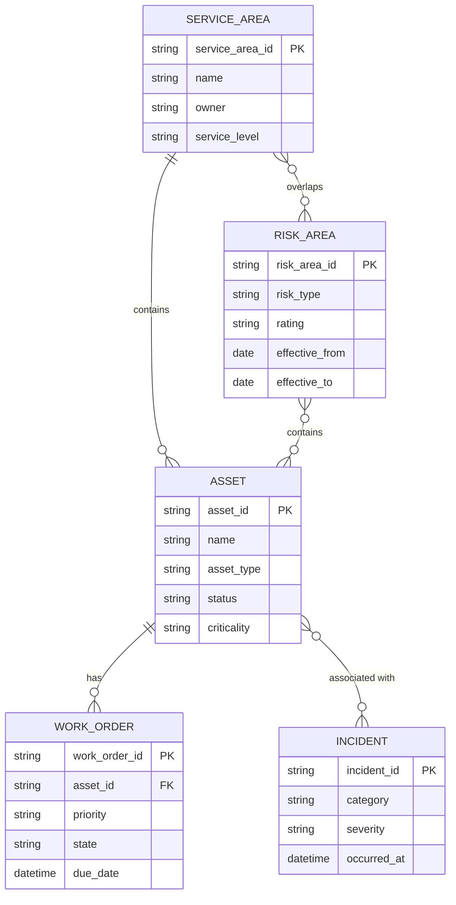

# Fabric IQ Spatial Intelligence End-to-End Scenario

## Scenario at a Glance

### Example POC Question

> Which operational assets are located within high-risk service areas, have open work orders, and are associated with recent incidents?

The scenario creates a bounded business model over governed data. GeoAnalytics computes the required spatial facts, ontology binds those facts to business entities and relationships, and users validate the results through structured exploration, optional graph views, ontology-agent questions, and a parallel map view.

## Why Four Stages

| Stage | Decision it proves | Primary output |
|---|---|---|
| 1. Establish the foundation | Can the customer safely run the preview POC? | Approved workspace, access, scope, owners, and test plan |
| 2. Prepare entities and relationships | Can authoritative data answer the spatial business question? | Governed entity and relationship tables |
| 3. Build and bind the ontology | Can the bounded business model be represented and connected to data? | Bound ontology with validated keys and relationships |
| 4. Explore and validate | Does the experience produce correct and useful business context? | Evidence-backed POC decision and operational backlog |

## End-to-End Flow

## Reference Data Model

The physical implementation can use separate relationship tables even when the conceptual diagram shows direct associations.

## Scenario Outputs

| Output | Description |
|---|---|
| Entity contract | Keys, names, properties, owners, sources, and freshness expectations |
| Relationship contract | Source and target keys, semantics, derivation method, lineage, and refresh |
| Governed OneLake tables | Testable entity and relationship records |
| Bound ontology | Bounded business model connected to governed data |
| Validation pack | Test questions, expected answers, sampled relationship checks, and findings |
| Decision record | Continue, revise, or stop, with preview and production gaps |

## Required Evidence

The scenario relies on:

- Ontology entities, relationships, and bindings: [IQ-003](records/Evidence.md#iq-003)
- Ontology creation paths: [IQ-004](records/Evidence.md#iq-004)
- Tenant requirements: [IQ-005](records/Evidence.md#iq-005)
- Tutorial behavior: [IQ-006](records/Evidence.md#iq-006)
- Optional graph exploration: [IQ-007](records/Evidence.md#iq-007)
- Optional ontology-agent experience: [IQ-008](records/Evidence.md#iq-008)
- Repository spatial-preparation boundary: [IQ-010](records/Evidence.md#iq-010)
- Separate ArcGIS Maps path: [IQ-011](records/Evidence.md#iq-011)

## Stage Sequence

1. [Stage 1: Establish the Foundation](03-Stage-1-Establish-the-Foundation.md)
2. [Stage 2: Prepare Entities and Relationships](04-Stage-2-Prepare-Entities-and-Relationships.md)
3. [Stage 3: Build and Bind the Ontology](05-Stage-3-Build-and-Bind-the-Ontology.md)
4. [Stage 4: Explore and Validate](06-Stage-4-Explore-and-Validate.md)
