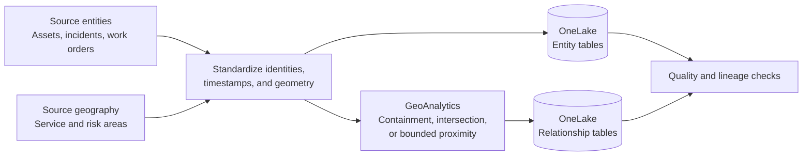

# Stage 2: Prepare Entities and Relationships

## Goal

Create governed, testable entity and relationship tables that answer the POC question without assuming undocumented ontology spatial behavior.

## Design Principle

Compute spatial facts before ontology binding:



This is a conservative repository pattern documented in [IQ-010](records/Evidence.md#iq-010). Native ontology spatial capabilities remain an open question in [GAP-IQ-002](records/Evidence.md#gap-iq-002).

## Tasks

### 1. Define Entity Contracts

For each entity, document:

- Business definition
- Stable primary key
- Display name
- Authoritative source
- Owner
- Required properties
- Geometry or spatial reference
- Effective dates or update timestamp
- Expected refresh frequency

Do not use a row number, display label, or mutable geometry as the entity key.

### 2. Standardize Inputs

Validate:

- Key uniqueness and null handling
- Coordinate reference systems
- Geometry validity
- Timestamp and time-zone conventions
- Status and category mappings
- Effective-date logic
- Data-classification controls

### 3. Derive Required Spatial Relationships

Create only the relationships needed for the POC:

| Relationship table | Source key | Target key | Example method |
|---|---|---|---|
| AssetServiceArea | asset_id | service_area_id | Point in polygon |
| AssetRiskArea | asset_id | risk_area_id | Point in polygon or intersection |
| AssetIncident | asset_id | incident_id | Governed business join or bounded nearest relationship |
| ServiceAreaRiskArea | service_area_id | risk_area_id | Polygon intersection; optional |

For a nearest or distance-based relationship, record the distance unit, threshold, tie-breaking rule, and geometry used.

### 4. Persist Lineage

Each relationship record should include:

- Relationship type
- Derivation method
- Processing timestamp
- Source-data version or batch identifier
- Quality status
- Distance or overlap measure when relevant

### 5. Validate Samples

Use independent review:

- Inspect known positive and negative cases.
- Compare selected results with an ArcGIS map or authoritative GIS.
- Investigate unmatched entities.
- Record boundary and precision behavior.
- Confirm that refresh produces stable keys and expected changes.

## Suggested Physical Tables

```text
dim_asset
fact_work_order
fact_incident
dim_service_area
dim_risk_area
rel_asset_service_area
rel_asset_risk_area
rel_asset_incident
```

Names are illustrative. Follow existing customer naming and medallion conventions where present.

## Stage Output

Produce:

- Approved entity and relationship contracts
- Governed OneLake tables
- Spatial-processing notebook or job reference
- Data-quality and lineage results
- Sample-validation record
- Refresh expectation

## Exit Gate

Proceed only if:

- Entity keys are unique and stable.
- Relationship keys resolve to valid entities.
- Spatial samples match authoritative expectations.
- Derivation and freshness are visible.
- Owners approve business meaning and data quality.

Do not use the ontology layer to hide unresolved data-quality or spatial-processing defects.
