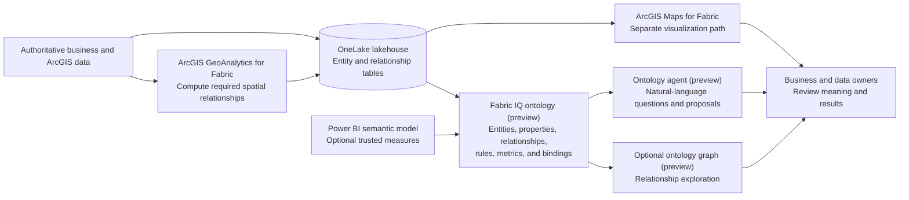

# Fabric IQ + Spatial Intelligence Architecture

## Purpose

This document defines the evidence-backed logical architecture for a bounded spatial-intelligence ontology proof of concept.

## Architectural Position

```text
Data → Spatial Processing → Spatial Experience → Business Context
```

The components remain independently governed:

- GeoAnalytics computes spatial relationships.
- OneLake stores governed entities and derived relationships.
- Fabric IQ ontology represents business meaning.
- ArcGIS Maps provides a separate map experience over supported data.

## Logical Reference Architecture



> [!IMPORTANT]
> The arrows describe a repository scenario assembled from independently documented capabilities. They do not assert a native Esri-to-Fabric-IQ integration or direct interoperability between ArcGIS Maps and ontology items.

## Minimum Data Contract

Each entity table should provide:

- Stable business key
- Human-readable name
- Source system and owner
- Validity or update timestamp
- Required business attributes
- Geometry reference or ArcGIS item identifier when relevant

Each relationship table should provide:

- Source entity key
- Target entity key
- Relationship type
- Derivation method
- Processing timestamp
- Source-data version or lineage reference
- Quality or confidence indicator when applicable

## Spatial Relationship Boundary

The MVP materializes only the spatial relationships needed for the customer question. Examples include:

- Asset within service area
- Asset within risk area
- Incident nearest asset
- Asset intersects operational boundary

Dynamic routing, network topology, proximity at arbitrary thresholds, and other query-time spatial behavior remain outside the ontology unless supported Fabric IQ capabilities are documented.

## Identity and Governance

Validate:

1. Fabric tenant and workspace access.
2. Ontology item creation permissions.
3. Source-data permissions for every bound table or model.
4. GeoAnalytics authorization for spatial processing.
5. ArcGIS content access for any map experience.
6. Owners for entity definitions, relationships, measures, and refresh.
7. Preview-feature approval and support expectations.

## Architecture Questions Still Open

1. Which ontology spatial capabilities are native and supported?
2. How do bindings respond to schema and key changes?
3. How are relationship-table refreshes reflected in ontology and graph experiences?
4. Which lineage and audit records are emitted?
5. Which limits apply to entity, relationship, and graph scale?
6. What production support and regional constraints apply during preview?
7. Can authoritative Esri domain models be mapped without losing product semantics?

## Validation Status

Logical Preview Architecture Supported; Direct Esri Integration and Production Architecture Validation Required
