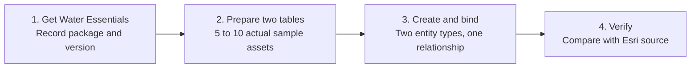
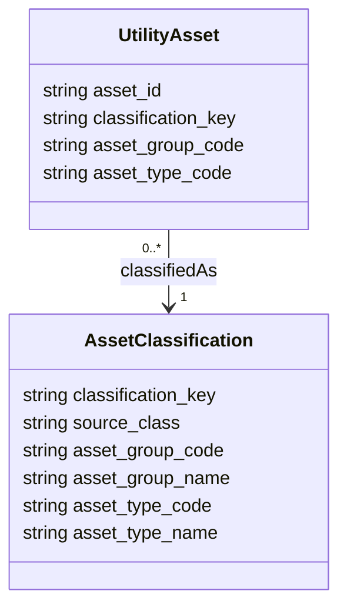
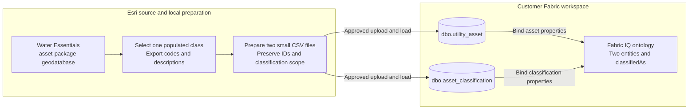

# Quickstart: Build a Utility Network-Grounded Ontology

Create a small Fabric IQ ontology from Esri Water Utility Network Essentials:
two entity types, two Lakehouse tables, and one classification relationship.

The customer question is:

> Which sampled water assets belong to each Esri asset group and asset type?

This is a Fabric IQ ontology grounded in an Esri model, not an Esri-published
formal ontology or a native asset-package import. Start here before the broader
[spatial-intelligence MVP](02-End-to-End-Scenario.md).

> [!IMPORTANT]
> Ontology is in preview. The product building blocks below are documented;
> this specific package-to-ontology walkthrough has not been executed against
> a downloaded package and a live Fabric tenant. Validate the selected package's
> fields, permissions, bindings, and results before using it in a customer demo.

## The Four-Stage Journey

**Scenario view:** repository guidance, not an Esri- or Microsoft-published
reference architecture. Four stages do not mean four UI clicks.



For the shortest live session, the facilitator completes stages 1 and 2 first,
then the customer creates and verifies the ontology in stages 3 and 4. Preparation
is real work, not an automatic integration. This repository does not bundle Esri
sample data, a converter, or a prebuilt ontology.

## Before You Start

- Review [Security and Governance Readiness](../01-Microsoft-Esri-Foundation/Security-and-Governance-Readiness.md)
  with the customer owners. Scope controls to this sample-data exercise and
  record approval before uploading data; Purview and Sentinel are not automatic
  prerequisites.
- Obtain an ArcGIS organizational account and appropriate ArcGIS Pro access.
  Esri lists the Professional user type for the Water Essentials information
  product; confirm current entitlement and deployment requirements.
- Use a Fabric-capacity workspace where you can create a Lakehouse and an
  ontology, and read the source tables.
- Have the Fabric administrator enable **Users can create Fabric items** and
  **Users can create ontology (preview) items** for the intended users.
- Obtain approval for preview use and the chosen data. Use Esri's sample records,
  not customer infrastructure data, for the first exercise.
- Confirm package usage rights before copying data into Fabric or sharing it.
  Do not commit package contents, credentials, or customer data to this repository.

Sources: [Water Foundation availability](records/Source-Register.md#src-iq-esri-007)
and [Fabric tutorial prerequisites](records/Source-Register.md#src-iq-msft-006).
The broader [foundation checklist](03-Stage-1-Establish-the-Foundation.md)
provides governance context; its five-entity spatial scenario is not required here.

## 1. Get Water Essentials

1. Open Esri's [Water Utility Network Foundation introduction](https://doc.arcgis.com/en/arcgis-solutions/latest/reference/introduction-to-water-distribution-utility-network-foundation.htm).
   Follow **Deploy the solution**, then download **Water Utility Network
   Essentials** from your organization. Choose Essentials, not Expanded, for
   this first exercise.
2. Extract the download and locate the asset-package file geodatabase. Open
   ArcGIS Pro and add that geodatabase through the Catalog pane. Inspect its
   contents without applying it to a new utility network.
3. Locate one populated water-device feature class. Record its actual name;
   `WaterDevice` is an example, not a guaranteed name across package versions.
   Use only that class in this exercise.
4. Record the solution item URL, package release or download date, geodatabase
   name, feature-class name, and selected record IDs. Use the linked
   **Water Essentials data dictionary** on Esri's introduction page to review
   field definitions and classification meanings.

Esri documents an Essentials download containing a project package, asset-type
map, style files, sample data, and an asset-package geodatabase
([IQ-015](records/Evidence.md#iq-015)). Inspect the actual download: if the
selected class has no records, locate the supplied sample data with the matching
schema. Stop if no matching populated class is available; do not invent asset
instances from schema definitions.

You do not need to create an enterprise geodatabase, publish a feature service,
apply an asset package, or enable network topology for this classification exercise.

## 2. Prepare Two Small Lakehouse Tables

### Export One Class

1. In ArcGIS Pro, select 5 to 10 records from the chosen feature layer. Include
   at least two distinct asset-group/asset-type combinations so the relationship
   is visible. Record the selected count and IDs.
2. Run **Export Table** against the selected layer, not the unfiltered Catalog
   dataset. Write the output to a folder as a `.csv` file. Keep **Use Field Alias
   as Name** unchecked and retain `GlobalID`, `ASSETGROUP`, and `ASSETTYPE`.
   Under **Environments**, enable **Transfer field domain descriptions**.
3. Inspect the CSV. Esri documents additional description fields prefixed with
   `d_`; expect equivalents of `d_ASSETGROUP` and `d_ASSETTYPE` alongside the
   numeric codes. Confirm the actual headers and compare descriptions with the
   source's subtype and coded-value domain definitions. If descriptions are
   absent or ambiguous, resolve the export or domain mapping before continuing.

See [Export Table](records/Source-Register.md#src-iq-esri-008) and
[Transfer field domain descriptions](records/Source-Register.md#src-iq-esri-009).
An asset-type code is scoped by its asset group; do not look up its label using
the code alone.

### Shape Two CSV Files

For this small exercise, use a spreadsheet or approved table editor. Preserve
Global IDs and codes as text. Do not generate replacement IDs or substitute
display labels for keys.

Create `utility_asset.csv` with these headers:

```text
asset_id,classification_key,asset_group_code,asset_type_code
```

Create `asset_classification.csv` with these headers:

```text
classification_key,source_class,asset_group_code,asset_group_name,asset_type_code,asset_type_name
```

Use this mapping:

| Output field          | Source or preparation rule                                                           |
|-----------------------|--------------------------------------------------------------------------------------|
| `asset_id`            | Original `GlobalID`, preserved as text                                                |
| `source_class`        | Actual feature-class name recorded in stage 1                                        |
| `asset_group_code`    | Original `ASSETGROUP` code, preserved as text                                         |
| `asset_group_name`    | Verified asset-group description from the export                                     |
| `asset_type_code`     | Original `ASSETTYPE` code, preserved as text                                          |
| `asset_type_name`     | Verified asset-type description for that group                                       |
| `classification_key` | Join source class, group code, and type code with `\|`, identically in both CSV files |

For example, a key has the shape `<source_class>|<group_code>|<type_code>`.
Use actual source values, not the placeholder text. Codes determine identity;
names provide meaning. This key is scoped to one package snapshot and does not
assert cross-version identity.

Keep one asset row per selected Global ID. In the classification file, retain
one row per distinct classification key, removing repeated identical
classifications. If one key has conflicting names, stop and resolve it with the
domain owner rather than choosing an arbitrary label.

### Load the Tables

1. In Fabric, create a new Lakehouse named **WaterOntologyQuickstart** with
   **Lakehouse schemas** enabled. Using a fresh Lakehouse avoids overwriting
   existing customer tables.
2. Select **Get data > Upload files** and upload both prepared CSV files.
3. Under **Files**, select each file's **... > Load to Tables > New table**.
   Use `utility_asset` and `asset_classification` in the default `dbo` schema.
   Confirm comma delimiters, a header row, and string types for IDs and codes.
4. Preview both tables. Require 5 to 10 asset rows, unique nonempty asset IDs,
   at least two classification rows, unique nonempty classification keys,
   populated names, and a matching classification for every asset.

These upload and table-creation steps follow
[Microsoft's Lakehouse preparation tutorial](records/Source-Register.md#src-iq-msft-006).
Do not bind CSV files in **Files** directly: bind the resulting Lakehouse tables.

## 3. Create and Bind the Ontology

### Minimum Model

**Scenario view:** a proposed, domain-reviewed classification mapping. It is not
a claim that Esri asset types are natively imported as Fabric entity types.



Every sampled asset must have one classification. The `0..*` allows a
classification to describe many assets; for this prepared sample, classifications
are derived only from the selected assets. Cardinality is an acceptance rule
for this walkthrough, not an automatically enforced Utility Network constraint.

### Create the Item and Bind Both Entities

1. In the same workspace, select **+ New item > Ontology (preview)**. Name it
   **WaterUtilityOntologyQuickstart** and select **Create**.
2. Select **+ Add entity type**, name it **Utility Asset**, then select its
   **... > Bind data > Add**. In the OneLake catalog, choose
   **WaterOntologyQuickstart > dbo > utility_asset**.
3. Review the proposed properties, retain the four documented columns, and
   create the binding. In the entity configuration, set `asset_id` as its entity
   type key. Verify the editor saved that key.
4. Repeat for **Asset Classification**, bound to
   **WaterOntologyQuickstart > dbo > asset_classification**. Retain its six
   properties and set `classification_key` as the entity type key.
5. From **Utility Asset**, select **Add relationship**. Name it **classifiedAs**,
   set the origin to **Utility Asset** and target to **Asset Classification**,
   and create it.
6. In the relationship configuration, set the origin property to
   `classification_key` and the target property to `classification_key`.
   Save the relationship and verify both endpoints. The origin join property
   is not `asset_id`: several assets can share a classification.

The creation, column-to-property binding, and origin/target property-matching
workflow follows [Microsoft's ontology tutorial](records/Source-Register.md#src-iq-msft-013).
If the current preview UI differs, follow that documentation and recheck the
saved keys and mappings before continuing.

### Source and Binding Boundaries

**Scenario view:** data preparation is an explicit, customer-controlled transfer.
No automatic synchronization or direct `.gdb` import is asserted.



Do not model `B_Rules` as actual asset links. Do not infer connectivity from
classification, coordinates, or proximity. Instantiated network associations,
terminal behavior, and topology require separate analysis
([IQ-013](records/Evidence.md#iq-013)).

## 4. Verify the Result

1. In the ontology configuration, confirm both entity keys, both source-table
   bindings, all property mappings, and the saved **classifiedAs** join.
2. Open the Lakehouse SQL analytics endpoint and run the following read-only
   checks. The first query must return no rows. The second must show the
   selected asset count, the same distinct asset count, and zero unmatched assets.

```sql
SELECT classification_key, COUNT(*) AS row_count
FROM dbo.asset_classification
GROUP BY classification_key
HAVING COUNT(*) <> 1
    OR classification_key IS NULL
    OR TRIM(classification_key) = '';

SELECT
    COUNT(*) AS joined_asset_count,
    COUNT(DISTINCT a.asset_id) AS distinct_asset_count,
    SUM(CASE WHEN c.classification_key IS NULL THEN 1 ELSE 0 END)
        AS unmatched_assets
FROM dbo.utility_asset AS a
LEFT JOIN dbo.asset_classification AS c
    ON a.classification_key = c.classification_key;
```

3. Run this detail query. Compare every row, not just one example, with the
   recorded source Global IDs and the source's group/type descriptions.
   Require exactly the selected set of assets and the correct labels.

```sql
SELECT
    a.asset_id,
    c.source_class,
    c.asset_group_name,
    c.asset_type_name
FROM dbo.utility_asset AS a
JOIN dbo.asset_classification AS c
    ON a.classification_key = c.classification_key
ORDER BY a.asset_id;
```

4. Obtain domain-owner approval of the names and the meaning of **classifiedAs**.
   Record the source version, row counts, tested IDs, binding configuration,
   reviewer, and unresolved issues in the customer's approved POC record.

These SQL checks validate the source rows and intended join, not execution
inside the ontology. For an instance-level visual check, optionally select
**Manage graph** in the ontology, select both entities and **classifiedAs**,
and follow [Materialize an Ontology Graph](https://learn.microsoft.com/en-us/fabric/iq/ontology/how-to-use-ontology-graph).
Confirm eligible sources, keys, permissions, preview limitations, and capacity
implications first. Compare the materialized instances and edges with the same
expected set. Graph materialization adds work and is not required to create
the bound ontology.

> [!NOTE]
> The required endpoint is a configured, bound classification ontology with
> reconciled source data and reviewed mappings. Do not describe it as a validated
> network graph, an agent-answering system, or a production integration.

## Keep the First Exercise Small

No GeoAnalytics processing, Power BI semantic model, agent, streaming pipeline,
geometry binding, or operational Utility Network deployment is required for
this classification-only model.

The two-table approach and manual preparation are repository design choices,
not a vendor connector or a general-purpose converter. A schema-only package
can inform definitions but cannot populate asset instances. Reuse prepared
files only where licensing and access controls permit.

After the first result is accepted:

- Add an actual association only after resolving source/target Global IDs,
  association type, terminals where relevant, and relationship direction.
- Add spatial relationships through the
  [entity and relationship preparation stage](04-Stage-2-Prepare-Entities-and-Relationships.md)
  when the business question requires spatial computation.
- Add agent or graph experiences only after separately validating their
  prerequisites and answers.
- Design refresh, versioning, rebinding, and operational ownership before
  using changing customer data.

For model-equivalence questions, continue with
[Esri Domain Model Validation](Esri-Domain-Model-Validation.md). See
[IQ-015 through IQ-018](records/Evidence.md#iq-015) for the evidence boundary
and [GAP-IQ-005](records/Evidence.md#gap-iq-005) for the remaining semantic gap.
